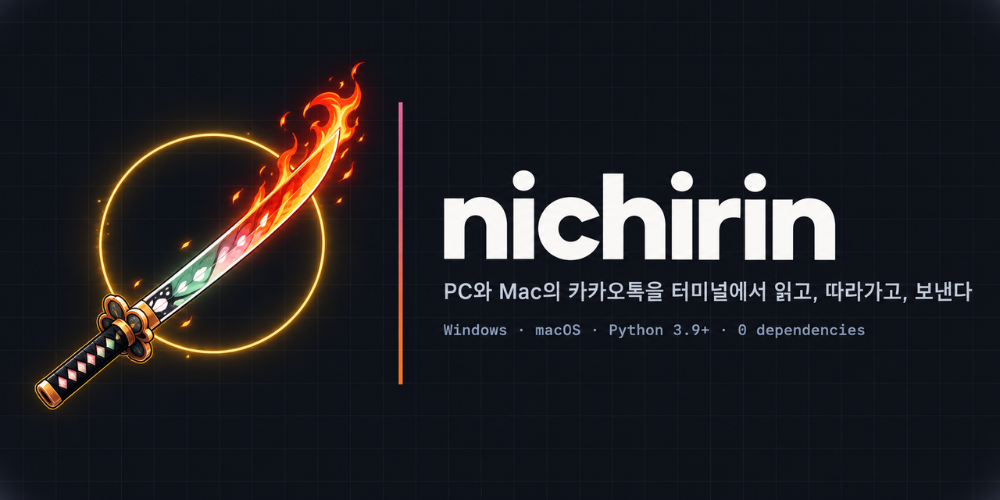
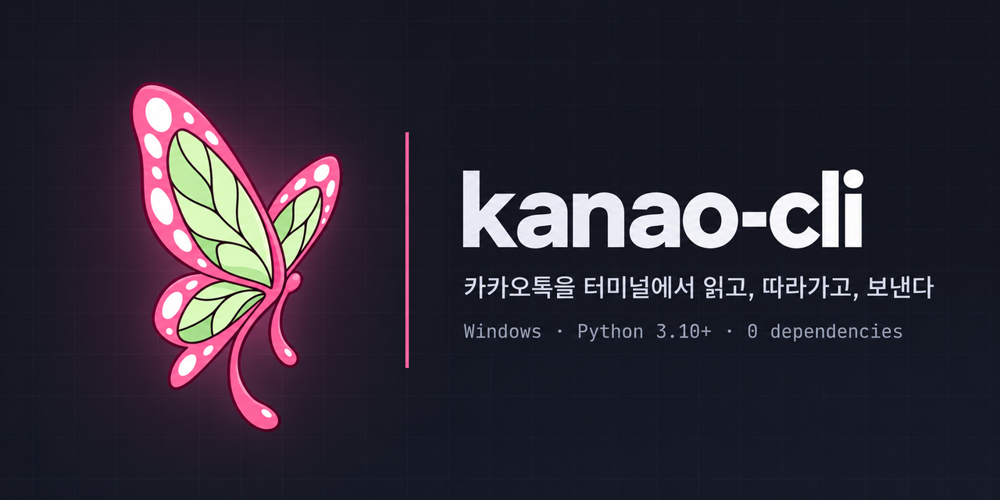

<div align="center">



# nichirin

**내 PC와 Mac의 카카오톡을 읽고, 따라가고, 보내는 CLI**

의존성 0개 · 읽기는 전부 로컬 · 파이썬 표준 라이브러리와 운영체제 API만


%20%C2%B7%203.10%2B%20(win)-3776AB?logo=python&logoColor=white)


[빠른 시작](#빠른-시작) · [두 빌드](#두-빌드) · [무엇을 하나](#무엇을-하나) ·
[저장소 구조](#저장소-구조) · [기여](#기여) · [예전 저장소에서 왔다면](#예전-저장소에서-왔다면) · [이름](#이름)

<br>

*One repository, two builds: a CLI that reads, follows and sends your own KakaoTalk on
Windows (`kanao`) and macOS (`kamado`). Korean-first documentation; every command
answers in JSON.*

</div>

## 빠른 시작

저장소 루트에서 `nichirin`으로 실행하면 이 컴퓨터에 맞는 빌드가 실행됩니다. Mac에서는
`kamado`, Windows에서는 `kanao`입니다. 인자와 JSON 봉투는 두 빌드가 같습니다.

```bash
git clone git@github.com:sanguneo/nichirin.git
cd nichirin

python -m nichirin status                 # 지금 무엇이 되는지
python -m nichirin context --room "이름"   # 방 하나를 통째로 이해하기
python -m nichirin follow --interval 1    # 새 메시지를 NDJSON으로
python -m nichirin tui                    # 터미널에서 직접 읽기

python install.py                         # 에이전트 스킬로 설치
```

Mac에서는 `python3`를 씁니다. 빌드 이름으로 직접 불러도 됩니다(`python -m kanao`,
`python3 -m kamado`). 합치기 전의 명령은 전부 그대로 동작합니다.

## 두 빌드

<table>
<tr>
<td width="50%" valign="top">



### Windows · `kanao`

실행 중인 카카오톡 메모리에서 방마다 키를 찾아 각 방의 DB를 읽고, Win32 입력으로
보냅니다. Python 3.10+.

[`windows/`](windows/) · [문서](windows/README.md) · [변경 기록](windows/CHANGELOG.md)

</td>
<td width="50%" valign="top">


### macOS · `kamado`

기기 정보로 키를 유도해 계정 DB 하나를 읽으므로, 카카오톡이 꺼져 있어도 읽습니다.
보내기는 손쉬운 사용(AX)으로 합니다. Python 3.9+.

[`macos/`](macos/) · [문서](macos/README.md) · [변경 기록](macos/CHANGELOG.md)

</td>
</tr>
</table>

## 무엇을 하나

- **읽기**: 방 목록, 대화, 검색, 요약(digest), 공지, 첨부, 친구 목록. 카카오톡 클라이언트가
  이미 저장해 둔 것만 읽고, 네트워크에는 나가지 않습니다.
- **따라가기**: `follow`가 새 메시지를 한 줄짜리 JSON으로 흘려 보냅니다.
- **보내기**: 명시적으로 시킨 글만, 클라이언트 창을 통해 보냅니다. `--dry-run`으로 먼저
  확인할 수 있습니다.
- **터미널 UI**: `tui`로 탭, 사진, 답장 인용까지 터미널에서 봅니다.
- **HTTP + SSE**: `serve`가 루트의 [`openapi.json`](openapi.json) 계약 하나에 답합니다.
  웹 클라이언트 [saya](https://github.com/sanguneo/saya)가 이 계약을 씁니다.

## 저장소 구조

| 경로 | 내용 |
| --- | --- |
| [`windows/`](windows/) | Windows 빌드: 패키지 `kanao`, 테스트, 스킬, 문서 |
| [`macos/`](macos/) | macOS 빌드: 패키지 `kamado`, 테스트, 스킬, 문서 |
| [`kakaocommon/`](kakaocommon/) | 두 빌드가 그대로 같이 쓰는 코드(`wal`, `sixel`) |
| [`openapi.json`](openapi.json) | 두 `serve`가 답하는 HTTP + SSE 계약 하나 |
| [`assets/`](assets/) | 저장소 로고와 소셜 미리보기 이미지 |
| `nichirin/`, `kanao/`, `kamado/`, `kakaoread/`, `install.py` | 루트 진입점. 자기 코드 없이 빌드로 연결만 합니다 |

테스트는 각 빌드 디렉터리에서 그 플랫폼 위에서 돌립니다.

```bash
cd windows && python -m unittest discover -t . -s tests    # Windows에서
cd macos && python3 -m unittest discover -t . -s tests     # Mac에서
```

## 기여

Mac만 있으면 Mac 쪽을, Windows만 있으면 Windows 쪽을 작업하고 테스트하면 됩니다. 다른 플랫폼에도 닿는
변경인데 그쪽을 테스트할 수 없다면 짧은 확인 요청 이슈를 남겨 주세요(강제는 아닙니다).
[CONTRIBUTING.md](CONTRIBUTING.md)에 흐름이 있습니다.

## 예전 저장소에서 왔다면

이 저장소는 `sanguneo/kanao-cli`와 `sanguneo/kamado-cli`를 합친 것입니다(#77). 두 저장소의
커밋 기록이 모두 남아 있습니다(`git log --follow windows/kanao/reader.py`).

- **kamado-cli를 clone해 두었다면** 주소가 이리로 리다이렉트되므로 그대로 `git pull`.
- **kanao-cli를 clone해 두었다면** 보관(archive)된 저장소이므로 이 저장소를 새로 clone.
- **스킬을 설치해 두었다면** 그대로 동작합니다. 업데이트할 때만 `python install.py --force`.

스킬 이름(`kanao-cli`, `kamado-cli`)과 실행 스크립트 경로, 각 빌드의 버전은 그대로입니다.
자세한 안내는 [#78](https://github.com/sanguneo/nichirin/issues/78)에 있습니다.

## 이름

두 빌드의 이름은 『귀멸의 칼날』에서 왔습니다. 카나오(kanao)와 카마도 탄지로(kamado)가 각자
쥐는 칼이 **일륜도(日輪刀, nichirin)**입니다. 쥐는 사람에 따라 칼날 색이 달라지는 같은 칼처럼,
한 저장소에 두 빌드가 있습니다. 이 칼을 감싸는 웹 클라이언트가 칼집 [saya](https://github.com/sanguneo/saya)(鞘)이고,
다른 메신저를 받아 주는 어댑터가 코등이 [tsuba](https://github.com/sanguneo/tsuba)(鍔)입니다.

## 라이선스와 면책

MIT([Windows](windows/LICENSE), [macOS](macos/LICENSE)). 카카오와 관계없는 비공식 도구이며, 자기
계정의 데이터를 자기 컴퓨터에서 읽는 용도입니다. 자세한 내용은
[windows/DISCLAIMER.md](windows/DISCLAIMER.md)를 읽어 주세요.
