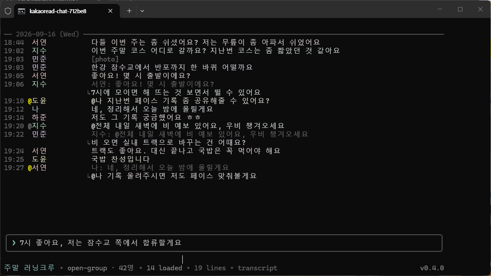
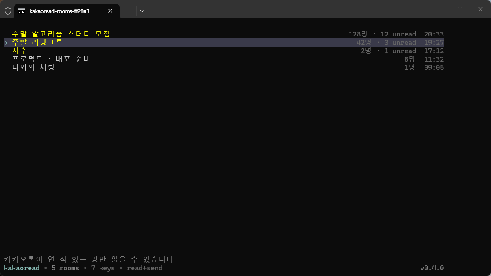
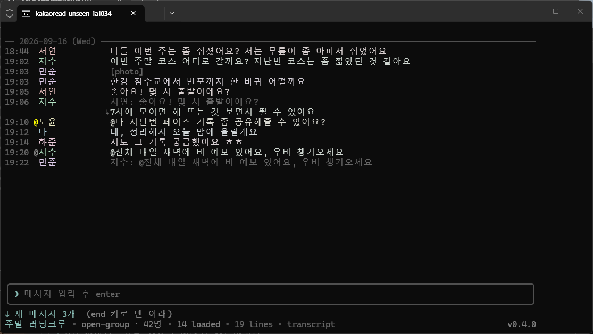
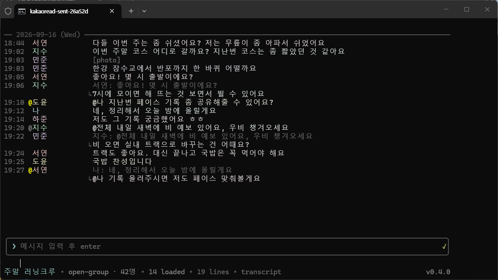
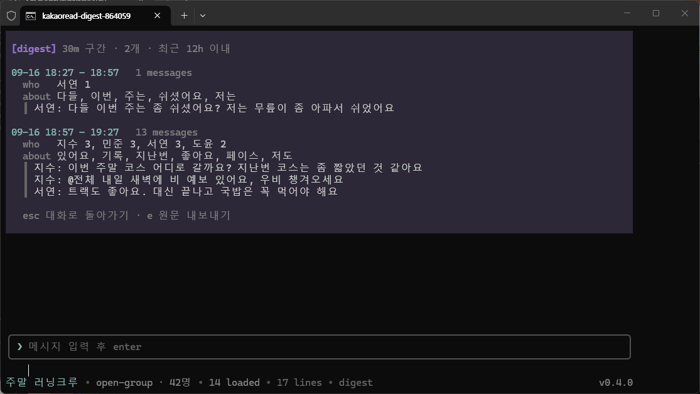
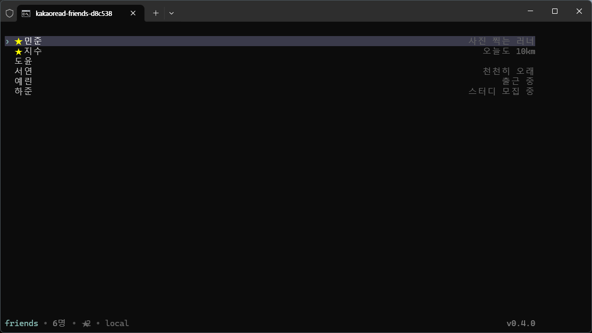
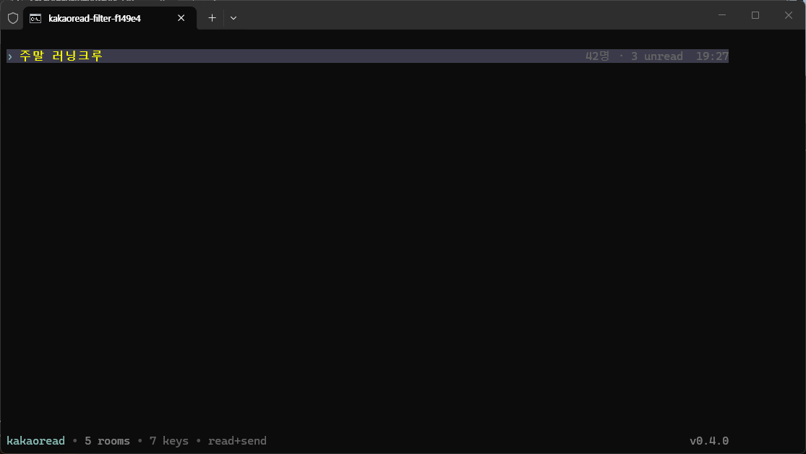
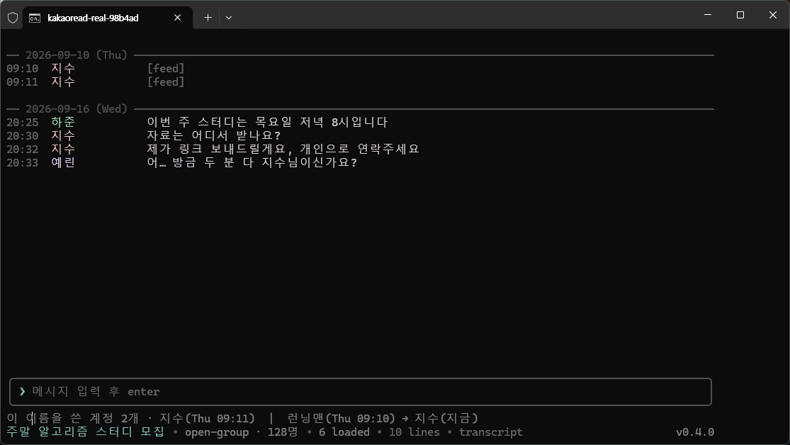
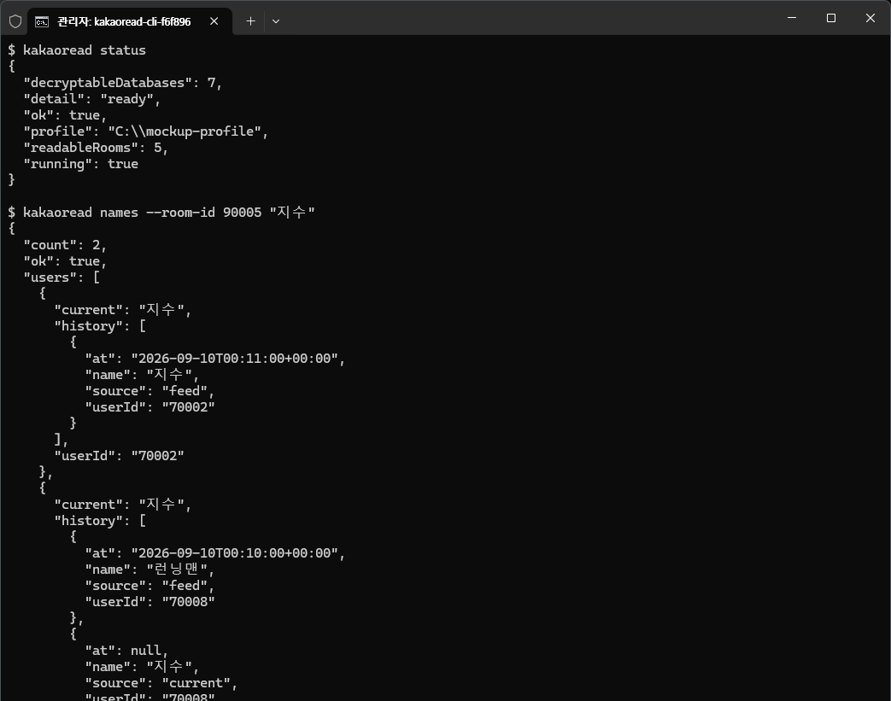

<div align="center">


# kanao-cli

**내 PC의 카카오톡을 읽고, 따라가고, 보내는 윈도우용 CLI**

의존성 0개 · 읽기는 전부 로컬 · 파이썬 표준 라이브러리와 윈도우 API만


**맥이라면 → [kamado-cli](https://github.com/sanguneo/kamado-cli)** · 같은 명령과 같은 JSON 봉투를 쓰는 macOS용 자매 프로젝트



<br><br>

[5분 안에](#5분-안에) · [무엇을 하나](#무엇을-하나) · [터미널에서 직접](#터미널에서-직접) ·
[이름 이력](#이름은-지금-이름일-뿐입니다) · [보내기](#보내기) ·
[에이전트](#ai-에이전트에-붙이기) · [성능](#값으로-말하는-성능) · [못 하는 것](#못-하는-것)

<br>

*A Windows CLI that reads, follows and sends your own KakaoTalk, with no third-party
dependencies. Korean-first documentation; every command answers in JSON.*

<br>

</div>

> [!NOTE]
> 이 문서의 스크린샷은 전부 `demo/mockup.py`가 메모리에 만든 **합성 데이터**입니다.
> 실제 대화도, 실존하는 사람도 한 줄 들어 있지 않습니다.

---

## 5분 안에

```powershell
python -m kanao status                     # 지금 무엇이 되는지
python -m kanao context --room "이름"       # 방 하나를 통째로 이해하기
python -m kanao follow --interval 1        # 새 메시지를 NDJSON 으로
python -m kanao names --room-id 123 "닉"   # 그 이름을 쓴 계정 전부
python -m kanao send --room "이름" "안녕"   # 실제로 보내기
python -m kanao tui                        # 터미널에서 직접 읽기
```

> 이 도구는 `kakaoread` 라는 이름이었습니다. **예전 명령도 그대로 동작합니다** —
> `python -m kakaoread`, `kakaoread`, `scripts/kakaoread.py`, `import kakaoread` 는
> 모두 현재 이름으로 이어지고, 바뀐 이름을 stderr 로 한 줄 알려줍니다. 임포트는 같은
> 모듈 객체로 이어지므로 `KanaoError` 는 어느 이름으로 잡아도 같은 클래스입니다.

`context` 한 번이면 방을 찾고, 최근 대화를 시간순으로 주고, **그 기록이 어디까지
닿는지**까지 말해줍니다. 에이전트가 `status` → `rooms` → `messages` 로 세 번 물을 이유가
없습니다.

모든 명령은 같은 봉투로 답합니다. 성공은 `{"ok": true, ...}`, 실패는
`{"ok": false, "error": {"code", "message"}}`. 종료 코드는 0, 처리된 실패는 1,
잘못된 호출은 2. **모든 식별자는 문자열입니다** — 카카오톡 아이디는 2^53을 넘어서
평범한 JSON 파싱이 숫자를 망가뜨립니다.

## 무엇을 하나

| | |
| --- | --- |
| **읽기** | 실행 중인 클라이언트 메모리에서 열쇠를 찾아 로컬 DB를 복호화합니다. 읽기 전용, 네트워크 없음 → [원리](#이-도구가-푸는-문제) |
| **따라가기** | 바뀐 방만 stat으로 골라내 새 메시지를 NDJSON으로 흘려보냅니다. 놀고 있는 방은 0.3 ms → [성능](#값으로-말하는-성능) |
| **읽는 화면** | 터미널 안의 대화방·대화·친구 목록·다이제스트, 그리고 답장과 멘션 표시 → [터미널](#터미널에서-직접) |
| **이름 이력** | 같은 닉네임을 쓰는 계정이 둘일 때 누가 원래 누구였는지 → [이름](#이름은-지금-이름일-뿐입니다) |
| **보내기** | 이미 로그인된 창에 글자만 넣습니다. 포커스도 커서도 건드리지 않음 → [보내기](#보내기) |
| **에이전트** | 한 번의 호출에 대화·커버리지·"나를 부른 줄"이 함께 → [스킬](#ai-에이전트에-붙이기) |
| **방 정보** | 공지, 공감, 수정됨과 수정 이력, 사진·동영상·파일·링크 모아보기, 세이프봇이 가린 메시지 켜고 끄기 → [방 정보](#방-정보) |
| **사진** | `tui`에서 `Ctrl+P`로 그 자리에 띄웁니다. 네트워크를 여는 **두 곳** 중 하나 → [사진](#사진) |

## 이 도구가 푸는 문제

카카오톡 데스크톱은 대화를 이 컴퓨터에 저장하지만 SQLCipher로 잠급니다. 그리고 그 열쇠는
**디스크 어디에도 없습니다.** 실행할 때마다 만들어져 클라이언트 프로세스의 메모리에만
존재합니다. 파일을 아무리 뜯어도 열 수 없다는 뜻입니다.

kanao-cli는 실행 중인 `KakaoTalk.exe`의 힙에서 SQLCipher의 `codec_ctx` 구조를 찾아 그
열쇠를 **읽기 전용으로** 가져옵니다. 그리고 파일 선두 16바이트 salt가 같은 데이터베이스와
짝지어, 이름으로 추측하는 일 없이 "이 열쇠는 증명 가능하게 이 파일의 것"임을 확인합니다.
프로세스는 조회·읽기 권한으로만 열고, 쓰거나 멈추거나 디버거를 붙이지 않습니다.

보내기는 정반대로 접근합니다. 프로토콜을 흉내 내면 동시 접속으로 잡혀 계정이 위험해지므로,
**이미 로그인된 클라이언트의 입력창**에 글자를 넣고 엔터를 보냅니다. 새 세션도, 두 번째
로그인도 없습니다.

## 터미널에서 직접

```powershell
python -m kanao tui
```



대화방 목록, 대화, 친구 목록, 그리고 하단의 입력창. 글자를 치면 메시지가 되고 `/`로
시작하면 명령이 됩니다. **카카오톡이 한 번도 연 적 없는 방은 목록에 없습니다** — 열쇠가
메모리에 없어서 읽을 수 없고, 그 사실을 숨기지 않습니다.

답장은 카카오톡이 쌓는 순서 그대로 보여줍니다 — 시각과 닉네임 옆에 **무엇에 답한
것인지** 원문 한 줄이 흐리게 붙고, 답한 말은 바로 아랫줄에 `↳`와 함께 놓입니다. 원문이
화면 밖 한참 위에 있어도 보이는데, 클라이언트가 답장을 보낼 때 원문 사본을 함께
적어두기 때문입니다. 나를 `@`로 부른 줄은 시각 옆에 표시되고, `@전체`는 흐리게
구분됩니다.

방을 열어둔 채로 새 메시지가 들어오면 그 자리에서 이어붙는데, **위로 스크롤해 과거를
읽는 중이라면 화면을 빼앗지 않고** 상태줄에 `↓ 새 메시지 N개`로 알립니다. 보낸 메시지는
입력창 오른쪽 끝에 상태로 표시됩니다 — `*`는 클라이언트가 받아간 것, `✓`는 대화에서
되읽혀 확인된 것, `?`는 30초가 넘도록 돌아오지 않은 것입니다. **알리지 않고 표시만 하는
이유**는, 확신하지 못할 때 확신한 척하지 않기 위해서입니다.

<table>
<tr>
<td width="50%"></td>
<td width="50%"></td>
</tr>
<tr>
<td align="center"><sub>과거를 읽는 중이면 화면을 빼앗지 않고 상태줄로만 알립니다</sub></td>
<td align="center"><sub>테두리에 붙은 <code>✓</code> 하나 — 글자를 밀지 않는 자리에</sub></td>
</tr>
</table>

입력창에서 보낸 메시지는 그 방의 카카오톡 창이 닫혀 있어도 나갑니다. 읽고 있던 방이
대상이니 더 물을 것이 없어서, 창이 없으면 열고 보낸 뒤 최소화해둡니다.



`/sum`은 **요약하는 척하지 않습니다.** 이 프로세스 안에는 모델이 없으므로, 구간이 얼마나
바빴는지·누가 이끌었는지·실제로 쓰인 단어와 대표 문장을 뽑아줄 뿐 문장을 지어내지
않습니다. `/export`로 원문을 내보내 모델에게 맡기세요.

화자는 색이 아니라 **미세한 색조**로 구분합니다. 같은 회색에서 조금씩만 틀어, 긴 대화가
알록달록해지지 않게 했습니다.

<table>
<tr>
<td width="50%"></td>
<td width="50%"></td>
</tr>
<tr>
<td align="center"><sub>친구 목록은 <code>f</code>로. 전화번호는 <code>--with-phone</code>을 적을 때만</sub></td>
<td align="center"><sub><code>/</code>로 좁히고 <code>esc</code>로 해제. 목록에서 글자는 여전히 단축키라서</sub></td>
</tr>
</table>

<details>
<summary><b>키 전체 보기</b></summary>

<br>

| 키 | 하는 일 |
| --- | --- |
| 글자 입력 | 메시지 작성 (대화방에서는 글자가 단축키가 아닙니다) |
| `←` `→` `del` `backspace` | 커서 이동과 그 자리 편집 |
| `shift+enter` | 줄바꿈. 붙여넣은 줄바꿈도 전송되지 않고 들어갑니다 |
| `ctrl+u` | 입력창 비우기 |
| `ctrl+t`, `/time` | 메시지 앞 시각 보이기 ↔ 숨기기. 숨기면 좁은 창에서 본문이 7칸 넓어집니다 |
| `ctrl+s`, `/status` | 맨 아래 상태줄(참여자 수·불러온 수·버전) 보이기 ↔ 숨기기. 숨기면 그 줄이 대화에 돌아갑니다 |
| `enter` | 전송. `/`로 시작하면 명령 |
| `/help`, `/?` | 키와 명령 전체. 대화 위 힌트 줄에는 `enter`·`esc`·`/help`만 적혀 있습니다 |
| `↑` `↓` `pgup` `pgdn` | 스크롤 |
| `/sum 30m`, `/sum 2h` | 구간별 다이제스트 (최대 12h) |
| `/older` `/export` `/back` `/quit` | 이전 기록 · 원문 내보내기 · 뒤로 · 종료 |
| `/real 닉네임` | 그 이름을 쓴 계정 전부와 각자의 이름 이력 |
| `/notice` | 방 공지 전체 (한 줄 요약은 대화 위에 늘 보입니다) |
| `/files` `/links` `/photos` `/videos` | 최근 200개 메시지에서 파일·링크·사진·동영상 모아보기 |
| `/edits` | 불러온 대화에서 수정된 메시지와 각 버전 |
| `/safebot` | 세이프봇이 가린 메시지를 보이기 ↔ 다시 가리기 (기본은 카카오톡처럼 가림) |
| `/open`, `/open 방이름` | 대화방을 **탭으로 하나 더** 열기 (`/close`로 닫기). 앞에 있는 방이 화면 전체 폭을 씁니다 |
| `tab` `shift+tab` | 다음 · 이전 탭으로 (여러 방이 열려 있을 때). 뒤에 있는 탭에 온 메시지는 탭에 `+N`으로 표시됩니다. 방 목록의 unread도 같은 규칙이라, 여기서 끝까지 본 방은 그 뒤에 온 것만 셉니다 |
| `f` | 목록 ↔ 친구 (친구에서 `enter`는 1:1 열기) |
| `esc` | 다이제스트·목록 닫기 → 지금 방만 닫기. **초안은 지우지 않고 방별로 기억합니다** |
| `/` | 대화방·친구 목록 걸러보기 (esc로 해제) |

화면 오른쪽이 잘려 보이면 스크롤바가 마지막 칸을 덮고 있는 것입니다. 기본값으로 한 칸을
비워두는데, `KANAO_TUI_MARGIN=2` 처럼 늘리거나 `0` 으로 되돌릴 수 있습니다.

</details>

`/time`·`/status`·`/safebot` 상태, 열어 둔 탭과 그중 앞에 있던 탭은 계정별로
`%LOCALAPPDATA%\kanao-cli\tui_state.json`에 저장되어 다음에 켤 때 그대로 돌아옵니다.
나간 방과 지금 잠긴 방은 건너뜁니다. 잠긴 방을 열려면 카카오톡 창을 띄워야 하는데, 화면을
켜자마자 그런 일이 생기면 안 되기 때문입니다. 파일에는 방 id와 스위치 세 개만 들어가고,
방 이름과 아직 보내지 않은 입력은 들어가지 않습니다. `python -m kanao tui --fresh`는 저장된
상태를 읽지도 쓰지도 않고 새로 시작합니다.

## 방 정보

카카오톡이 방 DB에 적어 두는 것 중 대화 줄 말고도 읽을 만한 것들입니다. 모두 이미
복호화하는 DB에서 표 하나를 더 읽을 뿐이라 새 열쇠나 권한이 필요 없습니다.

| | 화면 | 명령 | JSON |
| --- | --- | --- | --- |
| **공감** | 메시지 아래 `공감 사랑 3 · 엄지척 1` | — | `reactions: [{label, count, code}]` |
| **수정됨** | 메시지 끝에 `(수정됨)`, `/edits`로 버전 전부 | `revisions --message-id` | `edited: true` |
| **공지** | 대화 위 한 줄, `/notice`로 전체 | `notice` | — |
| **모아보기** | `/files` `/links` `/photos` `/videos` | `attachments --kind` | 주소·이름·크기·만료 |
| **세이프봇** | "세이프봇에 의해 가려진 메시지입니다.", `/safebot`으로 켜고 끄기 | `--show-covered` | `covered: "safebot"` |

누가 공감했는지는 클라이언트가 저장하지 않아 종류별 개수만 있습니다. 공지는 톡게시판
글이 예전 공지 칸보다 우선합니다 — 둘 다 있는 방에서는 예전 칸이 늘 더 오래된 것이었습니다.
모두에게 삭제된 메시지는 수정 이력도 돌려주지 않습니다. 이력이 원문을 되살리기 때문입니다.
가려진 메시지는 검색·인용·링크 목록에서도 가려진 채로 남고, `--show-covered`나
`/safebot`을 줄 때만 드러납니다.

## 사진

`tui`에서 대화를 열고 **`Ctrl+P`** (또는 작성란에 `/photo`)를 누르면 가장 최근 사진이
그 자리에 그려지고, 다시 누르면 라벨로 돌아갑니다. 사진이 있는 줄은 `[photo ▸]`로
표시되고, 열려 있는 동안은 `[photo ▾]`입니다.

**이 도구에서 네트워크를 쓰는 곳은 여기와 `serve`의 `/file` 두 곳뿐입니다.** 다른 모든 읽기는 이미 이
컴퓨터에 있는 데이터로 답하지만 사진만은 그럴 수 없습니다 — 클라이언트가 사진을
픽셀이 아니라 CDN 주소로만 저장하기 때문입니다(로컬 `.cng` 캐시는 암호화되어 있고,
열쇠는 찾지 못했습니다). 그래서 사진을 여는 그 순간에만 아래 일이 일어납니다.

| | |
| --- | --- |
| **언제** | `Ctrl+P`를 누른 그때만. 방을 열거나 스크롤할 때는 아무것도 받지 않습니다 |
| **어디로** | `talk.kakaocdn.net`, `dn-talk.kakaocdn.net` (https만, 목록 밖 주소는 요청조차 안 함) |
| **무엇을** | 사진 한 장 (상한 8 MiB, 타임아웃 8초) |
| **어디에** | `%LOCALAPPDATA%\kanao-cli\photos\` — 주소를 해시로 바꾼 이름이라 파일명에 토큰이 남지 않습니다 |

캐시는 지워도 됩니다. 사진은 `tui`에서만 보이며, **CLI가 내는 JSON은 이 기능이 없을
때와 바이트 단위로 동일합니다.**

그림을 그리는 방법은 터미널에 맞춰 고릅니다. Windows Terminal(1.22+)은 **sixel**로
그리고 — `WT_SESSION`을 보고 알아냅니다 — kitty 계열과 iTerm2도 인식합니다. 사진을
픽셀로 푸는 일은 윈도우가 이미 가진 코덱(WIC)이 하므로 의존성은 여전히 0개입니다.
`KANAO_IMAGE=sixel|kitty|iterm2|none` 으로 직접 지정할 수 있고, `none`이면 사진
기능이 통째로 꺼집니다. 그리지 못하는 터미널에서는 여는 표시 없이 `[photo]`로 남습니다.

## 이름은 지금 이름일 뿐입니다

`Profile`과 `talkUser`는 덮어쓰기입니다. 그래서 **이 도구가 보여주는 모든 이름은 그
계정이 지금 쓰는 이름**이고, 옛 닉네임으로 보낸 메시지도 새 이름으로 보입니다. 서로를
흉내 내는 오픈채팅에서 이건 대화를 엉뚱한 사람에게 귀속시키는 지름길입니다 — 실제로
그렇게 요약한 글이 방에 올라간 적이 있고, 그걸 계기로 만든 기능입니다.

`userId`는 바뀌지 않습니다. 두 계정이 이름을 글자까지 똑같이 쓸 수는 있어도 아이디를
나눠 가질 수는 없습니다. 그런데 **클라이언트는 개명을 어디에도 기록하지 않습니다.**
닉네임이 적히는 유일한 곳은 멤버십 피드(`type = 0`)이고, 그것도 누가 들어오거나 나가거나
초대될 때뿐입니다.

```powershell
python -m kanao names --room-id 123            # 이 방에서 이름을 바꾼 사람들
python -m kanao names --room-id 123 "닉네임"    # 그 이름을 쓴 적 있는 계정 전부
```

브라우저에서는 `/real 닉네임` 한 줄이면 됩니다. 답이 둘 이상 나오는 것은 모호함이 아니라
**그게 바로 사칭의 모습**입니다.



상태줄 한 줄이 답입니다 — `이 이름을 쓴 계정 2개 · 지수 | 런닝맨 → 지수(지금)`.
둘 중 누가 원래 그 이름이었는지, 누가 나중에 가져다 썼는지.

> [!IMPORTANT]
> 이름 이력은 `names.py`가 `%LOCALAPPDATA%\kanao-cli\names.jsonl`에 스스로 적어 남깁니다.
> 주소만 남기는 `contexts.json`과 달리 **이 파일에는 실제 닉네임이 들어갑니다** — 이름
> 이력은 그것 없이 존재할 수 없습니다.

## 보내기

대화방 창이 **존재하기만** 하면 됩니다. 화면에 보일 필요는 없습니다 — 작업표시줄에
최소화해둔 창으로도 그대로 나갑니다. 포커스를 뺏지 않고 마우스 커서도 움직이지 않습니다.

```powershell
python -m kanao send --room "이름" --dry-run "확인만"
python -m kanao send --room "이름" "보낼 말"
python -m kanao send --room "이름" --open "창이 닫혀 있어도"
```

`--open`은 창이 닫혀 있을 때 도구가 직접 엽니다. 카카오톡이 트레이에 내려가 있어도
메인 창을 되살려 목록을 열고, 방을 찾고, **연 창은 최소화해두고, 트레이는 도로
트레이로** 돌려놓습니다. 이미 열어두신 창은 건드리지 않습니다.

방은 카카오톡 **자체 검색**으로 찾습니다. 검색은 방 이름뿐 아니라 참여자 이름으로도
걸리므로, 대상 방이 결과 몇 번째에 나올지 카탈로그로 미리 계산해 **그 줄 하나만**
엽니다. 연 방은 최소화 버튼을 누른 것처럼 내려놓아서 **포커스는 쓰던 창으로
돌아갑니다.**

> [!WARNING]
> 목록의 행은 읽을 수 없고 누를 수만 있어서, 도구는 **열린 창의 제목이 정확히 일치할
> 때만** 그 방으로 인정합니다. 예측이 빗나가면 엉뚱한 방 하나가 잠깐 열렸다 닫히고,
> **그렇게 열린 방은 읽음 처리됩니다.**

### 한 번도 안 열린 방 읽기

키는 카카오톡이 그 방을 열었을 때만 메모리에 올라옵니다. 그래서 TUI 목록에는 모든
방이 보이고, 키가 없는 방은 흐리게 `잠김`으로 표시됩니다. 거기서 enter를 누르면
카카오톡에서 방을 열어 키를 불러온 뒤 바로 보여줍니다. 명령으로는:

```powershell
python -m kanao messages --room "이름" --open
```

카카오톡에서 방을 여는 것이므로 **그 방은 읽음 처리됩니다.** 방 창은 최소화된 채
남습니다 — 닫으면 키가 사라질 수 있습니다.

> [!IMPORTANT]
> `submitted: true`는 **입력창이 비워졌다**는 뜻이지 서버가 받았다는 뜻이 아닙니다.
> 확인하려면 `context`나 `messages`로 내 계정의 새 기록을 되읽으세요. 불확실한 전송을
> 자동으로 재시도하면 같은 말을 두 번 보내게 됩니다.

## 원격에서 보내고 읽기

Windows에 상주하는 프로세스가 HTTP 서버를 열면, 리눅스나 원격 외부에서 카카오톡
메시지를 보내고 읽을 수 있습니다. 표준 라이브러리만 쓰므로 설치할 것이 없습니다.

```powershell
# Windows (카카오톡이 실행 중인 머신)
$env:KANAO_TOKEN = "열여섯-글자-이상의-공유-비밀"
python -m kanao serve
```

```bash
# Linux / 원격 (SSH 포트포워딩: ssh -L 8765:127.0.0.1:8765 windows-host)
T=http://127.0.0.1:8765; H="Authorization: Bearer 열여섯-글자-이상의-공유-비밀"
curl -s $T/health
curl -s -H "$H" $T/rooms
curl -s -H "$H" "$T/context?roomId=1&limit=20"
curl -s -H "$H" "$T/digest?roomId=1&span=30m"
curl -s -X POST -H "$H" -H 'Content-Type: application/json' \
  -d '{"room": "가족", "text": "원격에서 보냄"}' $T/send
curl -N -H "$H" -H 'Accept: text/event-stream' $T/stream
```

| 메서드·경로 | 하는 일 |
| --- | --- |
| `GET /health` | 살아있는지 (토큰 불필요) |
| `GET /rooms` | 읽을 수 있는 방 목록 |
| `GET /context?roomId=…&limit=…` | 한 방의 최근 메시지 |
| `GET /digest?roomId=…&span=…&limit=…&highlights=…` | 같은 창을 추출 요약으로 (원문보다 훨씬 작습니다) |
| `GET /notice?roomId=…` | 방 공지 (없으면 `notice: null`) |
| `GET /attachments?roomId=…&kind=…&limit=…&beforeId=…` | 사진·동영상·파일·링크 모아보기 (`kind`는 `photo`·`video`·`file`·`link`) |
| `GET /revisions?roomId=…&messageId=…` | 수정된 메시지의 버전 전부 |
| `GET /file?roomId=…&messageId=…` | **파일 내려받기** — 바이트를 그대로 흘려보냅니다 (아래) |
| `POST /send` | `{"room", "text", "dryRun?", "openRoom?"}` — `send` 명령과 같은 경로 |
| `GET /stream` | **SSE** 실시간 새 메시지 — `event: ready` → `message` → `cursor` → `ping`, 실패 시 `event: error` 한 줄 뒤 종료. `?since=방id:logId`로 끊긴 지점부터 재개 |

**파일은 HTTP로 바로 받습니다.** 어떤 메시지가 파일인지는 `/attachments?kind=file`이
알려주고, `/file`이 그 파일을 내려보냅니다.

```bash
curl -OJ -H "$H" "$T/file?roomId=1&messageId=9006"
```

카카오톡이 `문서\카카오톡 받은 파일`에 저장해 둔 사본이 이름과 크기까지 맞으면 그걸
보내고(`X-Kanao-Source: local`, 네트워크 없음), 없으면 클라이언트의 CDN
(`talk.kakaocdn.net`, `dn-talk.kakaocdn.net`, `dn.talk.kakao.com`, https만)에서 받아
그대로 넘깁니다(`remote`). 파일 링크에는 만료가 있어서, 만료가 지났으면 요청하지 않고
`410 FILE_EXPIRED`로 답합니다 — 오래 둘 파일은 카카오톡에서 한 번 저장해 두세요. 파일명은
`Content-Disposition`의 `filename*`에 UTF-8로 담깁니다.

연속 전송은 서버에서 2초 간격을 강제하되 **버리지 않고 줄을 세웁니다** — 일찍 도착한
전송은 차례를 기다렸다 나가므로 연달아 보낸 둘이 순서대로 모두 도착합니다.
`429 RATE_LIMITED`는 "너무 이르다"가 아니라 **줄이 찼다**(전송 중인 것까지 4건)는
뜻이고, 간격은 `--min-interval`로 조절·`0`이면 끕니다. 토큰은 `--token`이나 `KANAO_TOKEN` 환경 변수로 주고(없으면 서버가
기동 거부), 16자 이상의 영숫자·`-._~+/=` 만 됩니다. 바인딩은 기본 `127.0.0.1` 이고
`--port`(기본 8765)·`--poll-interval`(스트림 폴링, 기본 1초)이 있습니다.
다른 머신에 직접 열려면 `--host 0.0.0.0`을 쓰되, 반드시 SSH 터널·VPN·TLS 종료
리버스 프록시 뒤에 두세요 — 평문 HTTP이므로 토큰이 그대로 노출됩니다.

API 명세는 [`openapi.json`](openapi.json)에 OpenAPI 3.1로 있습니다 — Swagger UI나
Postman에서 그대로 열리고, **맥 갈래(`kamado-cli`)와 바이트 단위로 같은 파일**입니다.
플랫폼마다 다른 몇 개는 문서 안에 `x-platform`으로 표시돼 있습니다.

**끊긴 사이는 커서로 메웁니다.** 스트림은 메시지를 보낸 뒤 `event: cursor`로
`{방id: logId}` 지도를 함께 보냅니다. 클라이언트는 이걸 들고 있다가 재접속할 때
`?since=방id:logId`로 되돌려 주면 되고(방마다 하나씩, 여러 번 반복 가능), 서버가 그
지점부터 따라잡은 뒤 실시간으로 넘어갑니다. `event: ready`에 `resumed: true`가 붙습니다.

```bash
curl -N -H "$H" "$T/stream?since=1001:5300&since=1002:412"
```

커서가 이름을 대지 않은 방은 **연결 시점부터** 시작합니다 — 본 적 없는 방에는 돌아갈
지점이 없기 때문이고, 그 공백은 `/context`로 메우면 됩니다. 메시지 id 하나로 계정 전체를
대신할 수 없어서 커서는 방마다 따로 적습니다. 폴링마다(`--poll-interval`, 기본 1초)
`event: ping`이 오고, 폴링 실패는 `event: error` 한 줄 뒤 연결이 닫힙니다.

조회량에는 상한이 있습니다. `limit`은 1~1000, `highlights`는 1~20이고 벗어나면
`400 INVALID_REQUEST`입니다(음수 `limit`은 SQLite에서 "제한 없음"이라 방 하나가
445,714개인 기록을 통째로 읽게 됩니다). 동시에 열 수 있는 `/stream`은 8개이고, 아홉
번째는 `503 BUSY`로 거절합니다 — 연결 하나가 리더와 워처를 통째로 붙들기 때문입니다.
본문을 약속해 놓고 보내지 않는 요청은 30초 뒤 `408`로 끊습니다.

| 무엇을 만났나 | 뜻 | 할 일 |
| --- | --- | --- |
| `401 UNAUTHORIZED` | 토큰이 없거나 틀림 | `Authorization: Bearer …` 확인 |
| `429 RATE_LIMITED` | 전송 대기열(4건)이 참 | 앞선 전송이 나간 뒤 재시도 |
| `404 INPUT_NOT_FOUND` | 창은 찾았는데 입력창이 없음 | 그 방 창을 다시 열기 |
| `404 MESSAGE_NOT_FOUND` | 그 방에 그런 메시지가 없거나 파일이 아님 | `/attachments?kind=file`에서 id 확인 |
| `410 FILE_EXPIRED` | 파일 링크가 만료됐고 저장된 사본도 없음 | 카카오톡에서 파일을 저장한 뒤 다시 |
| `503 KEY_UNAVAILABLE` | 카카오톡이 그 DB를 안 열어둠 | **방 창을 한 번 띄우기** (명령은 `messages --open`) |
| `status`에서 `decryptableDatabases: 0` | 힙 스캔이 빈손 | 아래 64비트 주의 |

> [!IMPORTANT]
> 카카오톡은 **64비트 빌드**로 쓰세요. 키를 찾는 `codec_ctx` 레이아웃은 64비트 실측값이라
> 32비트 클라이언트(`KakaoTalk(32-bit)`)에서는 스캔이 통째로 빗나가 `status`가
> `running: true, decryptableDatabases: 0`으로 나옵니다. 공식 다운로드에서 64비트를
> 받고 방을 하나 열면 바로 풀립니다.

쓰다 만 초안이 입력창에 남아 있으면 **지우고 보냅니다.** 보내는 사람은 이미 방과 할 말을
정한 상태고, 클라이언트 앞까지 걸어가야만 풀리는 거절은 끝내지도 않은 한 줄보다 비쌉니다.
대신 조용히 지우지는 않습니다 — 답에 `clearedDraft: true`가 붙고, `--dry-run`은 지우기
전에 `wouldClearDraft`로 미리 알려줍니다.

## AI 에이전트에 붙이기

```powershell
python install.py
python install.py --target "$HOME/.claude/skills/kanao-cli" --force
```

`~/.agents/skills/kanao-cli`에 스킬·런타임·라이선스를 복사합니다. 설치본은 자립형이라
원본 체크아웃을 옮기거나 지워도 계속 동작합니다. 설치 후에는 이렇게 시키면 됩니다.

> "카톡에서 지수랑 최근 대화 요약해줘."
> "회의 시간 얘기한 카톡 찾아줘."
> "이 대화 읽고 내 말투로 답장 초안 써줘. 보내지는 마."

에이전트가 받는 것은 사람이 보는 화면과 같은 사실입니다. `context` 하나에 방과
메시지뿐 아니라 **`coverage`**(로컬 한정인지, 카탈로그의 최신 메시지까지 닿았는지, 더
오래된 기록이 남아 있는지)와 **`attention`**(이 창에서 나를 부른 줄, 내 말에 달린 답장,
`@전체`)이 함께 옵니다. 답장에는 답한 원문이 `replyTo`로, 멘션에는 이름이 아니라
`userId`가 붙습니다 — 텍스트만 읽어서는 "내가 불렸는지"를 알 방법이 없기 때문입니다.
해당 없는 키는 아예 나오지 않습니다. 없는 것이 곧 아니라는 뜻입니다.



## 값으로 말하는 성능

느린 곳은 전부 측정해서 걷어냈습니다. 이 숫자들은 이 저장소의 `AGENTS.md`에 근거와 함께
남아 있습니다.

| 하는 일 | 전 | 후 |
| --- | --- | --- |
| `status` 한 번 | 2.43 s | **0.30 s** |
| `rooms` 한 번 | 2.54 s | **0.63 s** |
| `friends` 한 번 | 2.06 s | **0.38 s** |
| 힙에서 열쇠 찾기 | 426 ms ~ 2.8 s | **0.8 ms** (주소 재사용) |
| 프로필 DB 목록 | 1,363 ms | **92.8 ms** (`os.walk`) |
| 대화 20개 다시 읽기 | 1.0 s | **0.6 ms** (스냅샷 캐시) |
| 놀고 있는 방 1회 확인 | — | **0.3 ms** (stat 한 번) |

열쇠 탐색은 **주소만** `%LOCALAPPDATA%\kanao-cli\contexts.json`에 기억합니다. 키도
salt도 디스크에 쓰지 않으며, 기억한 주소도 새 후보와 똑같이 검증한 뒤에만 씁니다. 힙이
움직였으면 조용히 전체 탐색으로 되돌아갑니다.

## 필요한 것

윈도우 10 또는 11, 64비트 파이썬 3.10 이상, 그리고 **실행 중이며 로그인된**
카카오톡 데스크톱.

`pip install`도 가상환경도 없습니다. 서드파티 패키지를 쓰지 않습니다.

> [!TIP]
> **파이썬은 3.11 이상을 쓰세요.** 3.11부터 `sqlite3` 가 메모리 이미지를 그대로 받는
> `deserialize` 를 지원해서, 복호화 결과가 디스크를 아예 거치지 않습니다. 29.9 MB
> 카탈로그를 여는 데 **5.4 ms**, 같은 일을 3.10 에서는 임시 파일을 거쳐 **240.9 ms**
> 였습니다 — 데이터베이스를 열 때마다 235 ms 씩이고, 방 로그는 카탈로그보다 큽니다.
> 버전을 올리는 수단은 무엇이든 좋습니다. `uv` 로 `uv run --python 3.12 -m kanao status`
> 처럼 써도 되지만, 빨라지는 것은 uv 가 아니라 파이썬 쪽입니다 — uv 런처 자체는 명령마다
> 30 ms 남짓을 더합니다.

## 못 하는 것

- **로컬에 있는 것만.** 카카오톡이 한 번이라도 연 방만 열쇠가 메모리에 있습니다. 결과가
  비어 있다고 해서 그런 대화가 없었다는 증거는 아닙니다.
- **첨부는 사진만 그 자리에 그립니다.** `tui`에서 `Ctrl+P`(또는 `/photo`)로 사진을 터미널에
  띄울 수 있고, 동영상·파일·이모티콘은 `[video]`처럼 종류만 표시합니다. 파일은 `serve`의
  `/file`로 내려받을 수 있지만 링크가 만료되면 저장해 둔 사본이 있을 때만 됩니다.
- **글자만 보냅니다.** 첨부 전송, 로그인 자동화, 기록 내려받기는 없습니다.
- **쓰는 도중이면 물러납니다.** 클라이언트가 DB를 다시 쓰는 중이면 찢어진 결과를 주느니
  거절하고 다시 시도합니다.
- **무결성은 확인하지만 진위는 아닙니다.** SQLite 무결성과 로그 체크섬은 검증하고,
  SQLCipher의 페이지별 HMAC은 검증하지 않습니다.
- **3.10에서는** 복호화 결과가 임시 파일을 거칩니다. 삭제는 하지만 안전 소거는 아니고,
  여는 데 240.9 ms 가 듭니다(3.11+ 는 5.4 ms). 강제 종료로 남은 파일은 다음에 임시 파일을
  쓸 때 지웁니다. 단, 이 도구가 만든 이름이고, 내 계정 소유이며, 만든 프로세스가 끝난 것이
  확인된 파일만 지웁니다.
- **클라이언트가 바뀌면** 아무것도 못 읽게 될 수 있습니다.

## 개발

```powershell
python -m unittest discover -t . -s tests    # 전체 테스트
python demo/mockup.py chat                   # 합성 데이터로 인터페이스만 띄우기
```

테스트 577개가 모두 합성 데이터로 돕니다. AES는 NIST SP 800-38A 벡터로, 페이지와 로그
처리는 진짜 SQLite와 진짜 BCrypt 왕복으로 만든 픽스처로 검증합니다. **실제 대화·연락처·
열쇠는 저장소에도, 테스트에도, 로그에도 들어가지 않습니다.**

이 문서의 화면들은 `demo/`에서 나왔습니다. `mockup.py`는 실제 계정을 열지 않고 지어낸
프로필로 인터페이스만 보여주고, `capture.ps1`이 그 창을 찍습니다. 남의 대화로 스크린샷을
찍지 않기 위한 장치입니다.

코드를 고칠 생각이라면 `AGENTS.md`를 먼저 읽으세요. 측정으로 얻은 사실과, 모르고 건드리면
조용히 틀린 답을 내놓는 지점들이 적혀 있습니다.

## 출처와 라이선스

SQLCipher 컨테이너 구조, 열쇠 탐색 기법, 데이터베이스 분할 방식은
**[Brian ByungHyun Shin](https://github.com/brianshin22)** 의
[kakaocli](https://github.com/silver-flight-group/kakaocli)
(**[Silver Flight Group](https://github.com/silver-flight-group)**)에서 왔습니다.

MIT. [LICENSE](LICENSE) 참조.

## 면책

카카오와 제휴하거나 보증받지 않은 독립적인 비공식 프로젝트입니다. "카카오톡"과
"KakaoTalk"은 카카오의 상표입니다. 이 도구는 사용자 본인의 컴퓨터에 이미 저장된 데이터를
읽고, 전송 시에는 사용자 본인이 로그인해 둔 클라이언트를 조작합니다. 카카오 API를 호출하거나
프로토콜을 구현하거나 애플리케이션을 변조하지 않습니다.

**그 사실이 카카오 약관 준수나 이용 제한 면제를 뜻하지는 않습니다.** 보증 부인, 책임
제한, 그리고 맞게 동작해도 손해가 날 수 있는 지점들은 [DISCLAIMER.md](DISCLAIMER.md)에
따로 적어 두었습니다 — 보내기나 `serve`를 쓰기 전에 한 번 읽으십시오.

*Not affiliated with or endorsed by Kakao Corp. Reads data already on your own
machine and drives your own signed-in client; no Kakao API calls, no protocol
reimplementation, no patching of the application. That is not a claim of
compliance — see [DISCLAIMER.md](DISCLAIMER.md).*
