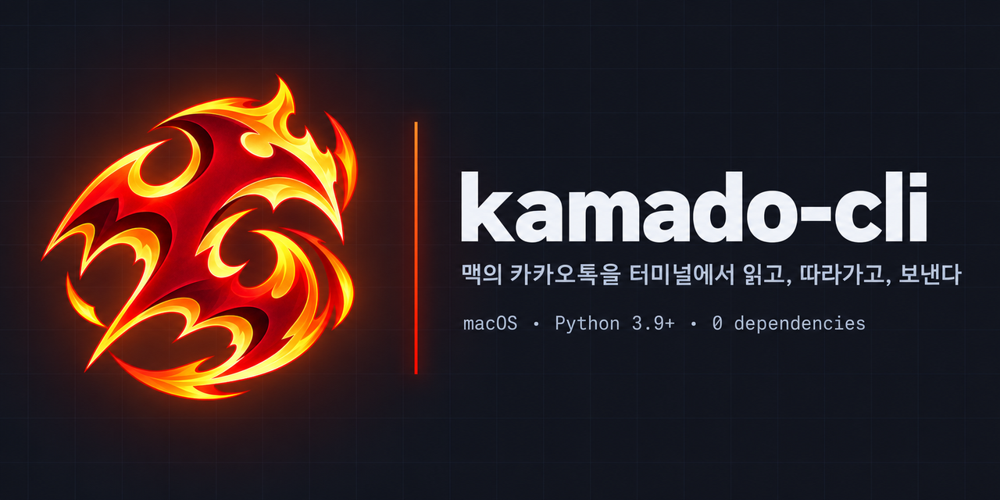
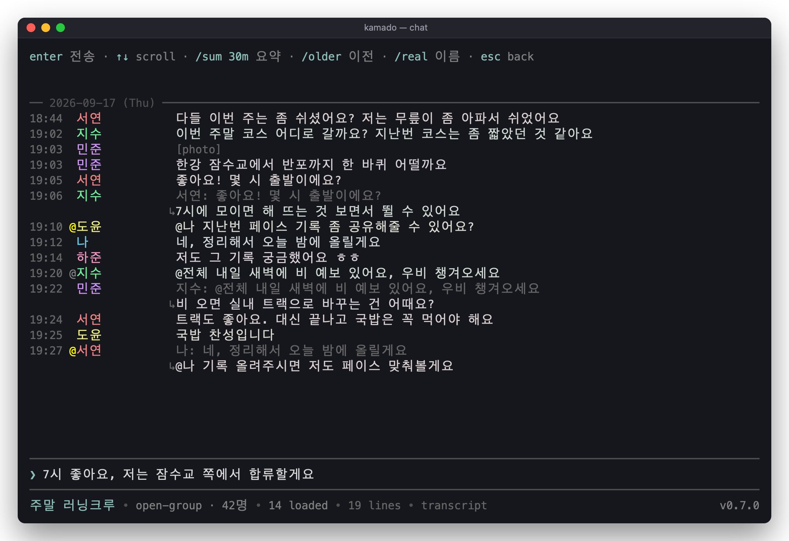
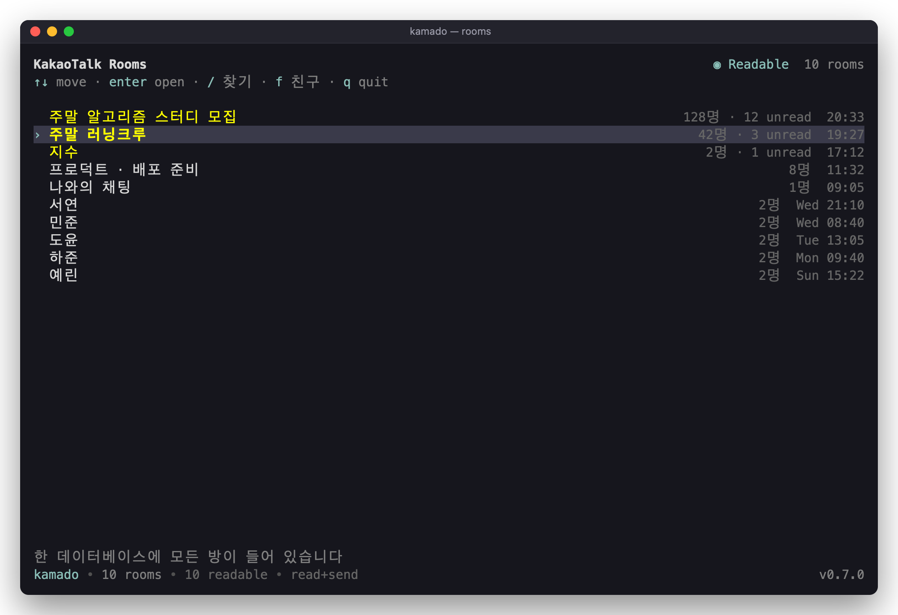
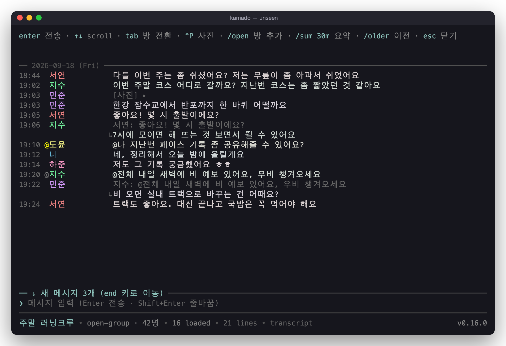
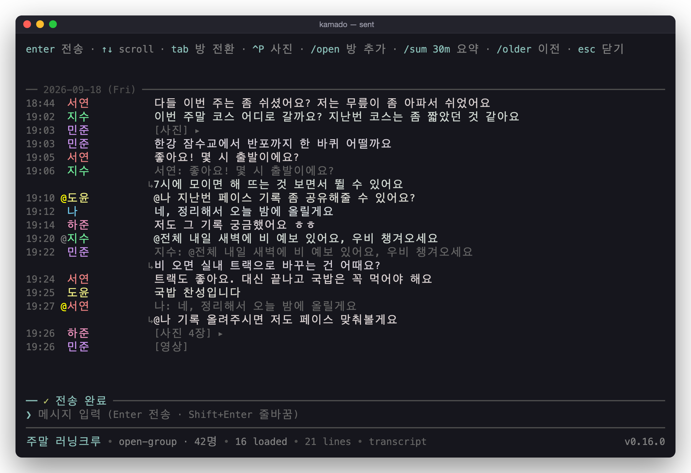
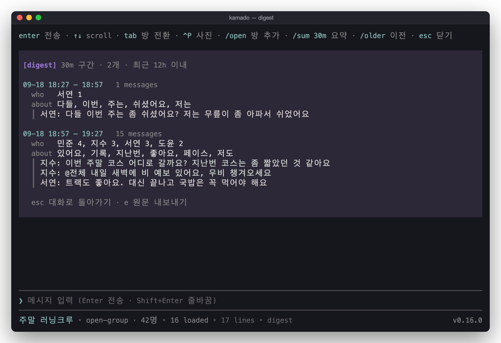
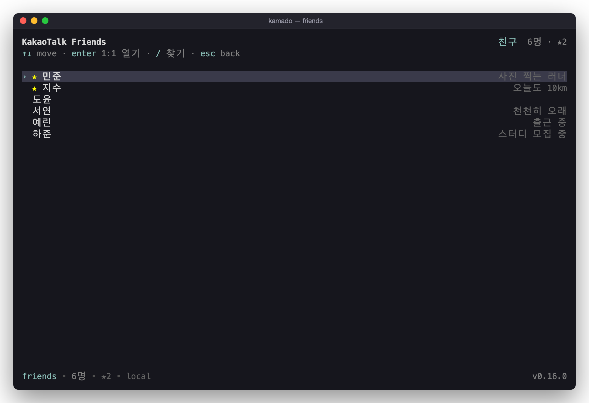
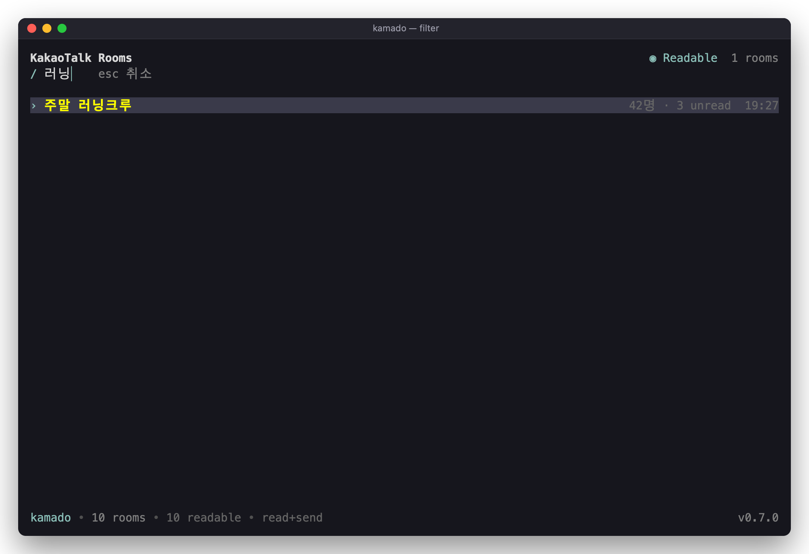
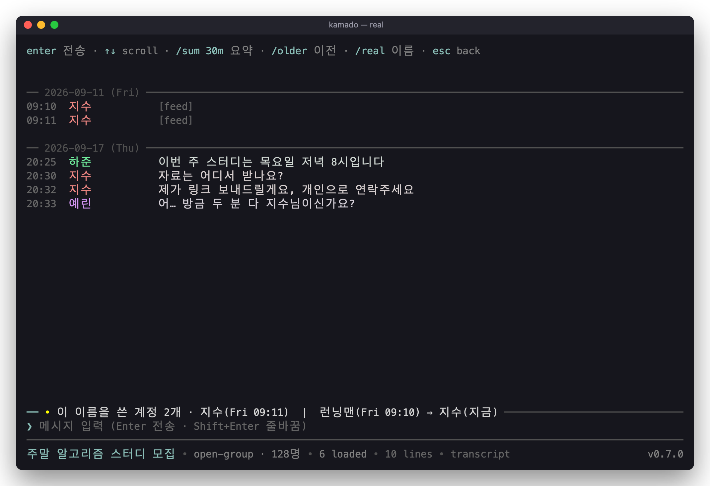
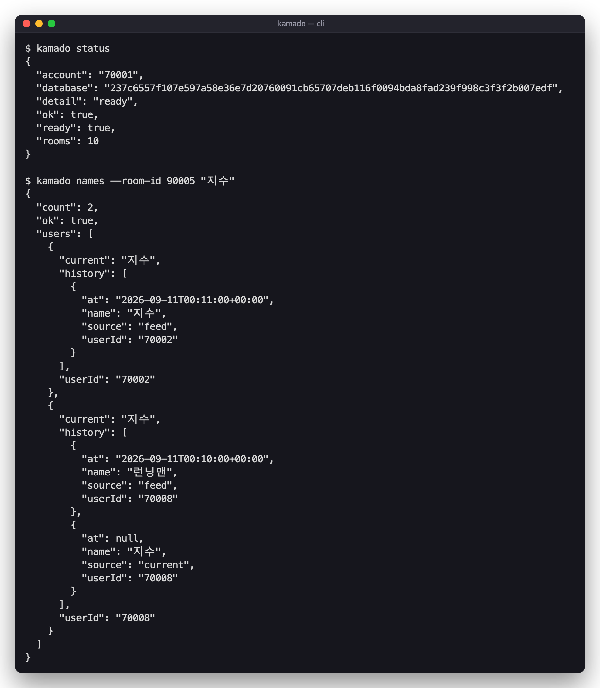

<div align="center">



# kamado-cli

**내 Mac의 카카오톡을 읽고, 따라가고, 보내는 macOS용 CLI**

의존성 0개 · 읽기는 로컬에서 · 파이썬 표준 라이브러리와 macOS API만


**윈도우라면 → [kanao-cli](https://github.com/sanguneo/kanao-cli)** · 같은 명령과 같은 JSON 봉투를 쓰는 윈도우용 자매 프로젝트



<br><br>

[5분 안에](#5분-안에) · [무엇을 하나](#무엇을-하나) · [터미널에서 직접](#터미널에서-직접) ·
[이름 이력](#이름은-지금-이름일-뿐입니다) · [보내기](#보내기) ·
[에이전트](#ai-에이전트에-붙이기) · [못 하는 것](#못-하는-것)

<br>

*A macOS CLI that reads, follows and sends your own KakaoTalk, with no third-party
runtime dependencies. Korean-first documentation; structured commands answer in JSON.*

<br>

</div>

> [!NOTE]
> 이 문서의 스크린샷은 전부 `demo/mockup.py`가 메모리에 만든 **합성 데이터**입니다.
> 실제 대화도, 실존하는 사람도 한 줄 들어 있지 않습니다. macOS에서 지금 런타임으로
> 찍은 화면이며, 실제 계정을 촬영한 결과가 아닙니다.

---

## 5분 안에

macOS와 **Python 3.9 이상**, 이 Mac에 로그인한 카카오톡 계정의 로컬 데이터가 필요합니다.
macOS 15.7에서 확인했습니다. 저장소 디렉터리에서 실행하세요. `pip install`도 가상환경도
필수는 아닙니다. 서드파티 런타임 패키지를 쓰지 않습니다.

> [!TIP]
> **빠르게 하는 것은 파이썬 3.11+ 이고, `uv` 는 그것을 구하는 방법입니다.**
> 3.11 부터 `sqlite3` 가 메모리 이미지를 그대로 받는 `deserialize` 를 지원해서, 복호화
> 결과가 디스크를 아예 거치지 않습니다 — macOS 가 들고 오는 기본 Python 3.9 에서는
> 임시 파일을 거치므로 실행이 **3배 이상** 걸립니다(약 1.6s). uv 는 맥에 최신 파이썬을
> 얹는 가장 쉬운 수단일 뿐이고, 3.11+ 를 이미 쓰고 있다면 그대로 실행하는 편이 빠릅니다
> (uv 런처 자체는 명령마다 30 ms 남짓을 더합니다):
> ```bash
> uv run --python 3.12 -m kamado status
> uv run --python 3.12 -m kamado tui
> ```
> 상주하는 `serve` 는 차이가 더 큽니다. 카카오톡이 쓸 때마다 스냅샷을 다시 만들기 때문에,
> 3.9 에서는 갱신마다 DB 크기만큼의 임시 파일을 쓰고 읽습니다. 그래서 `serve` 는 3.9 에서
> 시작할 때 경고를 한 줄 찍습니다(아래 「원격에서 보내고 읽기」).

먼저 **시스템 설정 → 개인정보 보호 및 보안**에서 도구를 실행하는 **터미널 앱**
(iTerm 또는 Terminal)에 권한을 주세요. 파이썬 파일에 주는 권한이 아닙니다.

| 권한 | 필요한 때 |
| --- | --- |
| **전체 디스크 접근 권한 (Full Disk Access)** | 카카오톡 앱 컨테이너의 데이터 읽기 |
| **손쉬운 사용 (Accessibility)** | 클라이언트를 조작해 메시지 보내기 |

### SSH로 접속해서 실행할 때

SSH 세션에서 macOS가 권한을 확인하는 대상은 터미널 앱이 아니라 **SSH 서버**입니다.
그래서 터미널에 권한을 줬어도 SSH로 들어와 보내면 `PERMISSION_REQUIRED`
(`accessibility`)로 실패합니다. 읽기가 SSH에서도 되는 것은 원격 로그인 쪽에 이미
디스크 접근이 허용돼 있기 때문일 가능성이 큽니다. **시스템 설정 → 일반 → 공유 →
원격 로그인**의 "원격 사용자에게 전체 디스크 접근 허용"을 확인해 보세요.

SSH에서도 보내려면, 맥 앞에서 직접 다음을 설정하세요.

1. **시스템 설정 → 개인정보 보호 및 보안 → 손쉬운 사용**을 엽니다.
2. 목록 아래의 **＋**를 누릅니다. 관리자 암호나 Touch ID를 요구할 수 있습니다.
3. 파일 선택 창에서 **⌘ Cmd + ⇧ Shift + G**를 누르고 아래 경로를 넣은 뒤 Enter를
   누릅니다.
   ```
   /usr/libexec/sshd-keygen-wrapper
   ```
4. **열기**를 누르고, 목록에 추가된 `sshd-keygen-wrapper`의 스위치가 켜져 있는지
   확인합니다.
5. 기존 SSH 접속을 끊고 **새로 접속**합니다. 이미 열려 있던 세션에는 적용되지 않습니다.
6. `python3 -m kamado send --room "나와의 채팅" --dry-run "확인"`으로 먼저 확인합니다.

> [!WARNING]
> 이 권한은 kamado만이 아니라 이 맥에 SSH로 로그인하는 **모든 세션**에 적용됩니다.
> SSH 키나 비밀번호가 새면 원격에서 화면을 조작할 수 있게 됩니다. 쓰지 않을 때는
> 스위치를 꺼 두세요. macOS 업데이트 뒤에 권한이 풀리면 같은 과정을 다시 하면 됩니다.
>
> 권한을 넓히고 싶지 않다면, 맥 앞에서 직접 연 터미널로 `kamado serve`를 띄우고
> 원격에서는 HTTP로 보내는 방법이 있습니다. [원격에서 보내고 읽기](#원격에서-보내고-읽기)를
> 참고하세요.

권한이 없으면 macOS가 오류 대신 접근을 **멈춰 세울 수 있습니다.** 도구는 접근 시간 제한과
권한 검사로 무한 대기를 막고 `PERMISSION_REQUIRED`를 반환합니다. 응답의 `permission`은
`fullDiskAccess` 또는 `accessibility`입니다. `status`는 진단용 예외로, 실패해도
`ok: true`, `ready: false`, `detail`로 현재 상태를 설명할 수 있습니다.

```bash
python3 -m kamado status                      # 지금 무엇이 되는지
python3 -m kamado context --room "이름"        # 방 하나를 통째로 이해하기
python3 -m kamado follow --interval 1          # 새 메시지를 NDJSON으로
python3 -m kamado names --room-id 123 "닉"     # 그 이름을 쓴 계정 전부
python3 -m kamado send --room "이름" --dry-run "안녕"  # 보내기 전 확인
python3 -m kamado tui                         # 터미널에서 직접 읽기
```

**읽을 때는 카카오톡을 꺼도 됩니다.** 새 메시지가 로컬에 동기화되거나 실제로 전송되려면
클라이언트가 실행 중이어야 합니다.

`context` 한 번이면 방을 찾고, 최근 대화를 오래된 순으로 주고, **그 기록이 어디까지
닿는지**까지 말해줍니다. 방을 이미 안다면 `status` → `rooms` → `messages`로 세 번
물을 이유가 없습니다.

구조화된 명령의 성공은 `{"ok": true, ...}`, 실패는
`{"ok": false, "error": {"code": "...", "message": "..."}}`입니다.
처리된 실패는 종료 코드 1, 성공은 0, 잘못된 명령·인자는 2입니다. 인자 오류와 도움말은
일반 CLI 텍스트이고, `follow`는 한 줄씩 JSON, `tui`는 대화형 화면입니다.
**방·메시지·사용자 식별자는 문자열입니다** — 카카오톡 아이디는 2^53을 넘을 수 있습니다.
원시 SQL인 `query`는 SQLite 값을 그대로 돌려주므로 식별자는 `CAST(... AS TEXT)`로 읽으세요.

## 무엇을 하나

| | |
| --- | --- |
| **읽기** | 이 Mac과 계정 정보에서 열쇠를 유도해 로컬 DB를 복호화합니다. 읽기 전용, 서버 조회 없음 |
| **따라가기** | 계정 전체 DB와 로그의 변경을 확인해 새 메시지를 NDJSON으로 흘려보냅니다 |
| **읽는 화면** | 터미널 안의 대화방·대화·친구 목록·다이제스트, 답장과 멘션 표시 |
| **이름 이력** | 같은 닉네임을 쓰는 계정이 둘일 때, 이름이 아니라 `userId`로 구분 |
| **보내기** | 로그인된 클라이언트의 입력창에 글자를 넣고 전송 버튼 한 번. 포커스·커서·클립보드는 그대로 |
| **에이전트** | 한 번의 호출에 대화·커버리지·나를 부른 줄이 함께 |
| **방 정보** | 공지, 공감, 수정됨, 사진·동영상·파일·링크 모아보기, 세이프봇이 가린 메시지 켜고 끄기 → [방 정보](#방-정보) |

## 이 도구가 푸는 문제

카카오톡은 대화를 이 Mac에 저장하지만 SQLCipher로 잠급니다. macOS의 열쇠는 실행 중인
프로세스에서 찾는 것이 아닙니다. **기기의 `IOPlatformUUID`와 로그인한 계정의 `userId`**로
PBKDF2-HMAC-SHA256을 100,000회 적용해 유도합니다. 힙 스캔도, 실행 중인 클라이언트도
읽기에는 필요 없습니다.

계정의 방·메시지·사용자는 다음 디렉터리의 **DB 하나**에 들어 있습니다.
파일 이름은 78자리 16진수입니다. 방마다 파일과 열쇠가 따로 있는 구조가 아닙니다.

```text
~/Library/Containers/com.kakao.KakaoTalkMac/Data/Library/Application Support/com.kakao.KakaoTalkMac/
```

주요 테이블은 `NTChatRoom`, `NTChatMessage`, `NTUser`, `NTOpenLink`, `NTChatContext`입니다.
확인한 클라이언트는 SQLCipher v3(페이지 1024바이트, 예약 영역 48바이트)를 쓰며,
도구는 v3/v4 형식을 자동 판별합니다. AES는 `ctypes`로 macOS **CommonCrypto**를 호출합니다.
별도 암호화 패키지를 설치하지 않습니다.

클라이언트가 큰 DB를 계속 쓰는 동안 원본을 끝까지 읽으려 하면 시작과 끝이 달라집니다.
그래서 먼저 APFS의 **copy-on-write 복제(`cp -c`)**로 고정된 사본을 만들고 복호화합니다.
복제는 파일 크기만큼 다시 쓰지 않습니다. 복제를 지원하지 않는 파일시스템에서는 일반
복사로 돌아갑니다. DB가 바뀌지 않으면 같은 프로세스 안에서 복호화된 스냅샷을 재사용합니다.
복제가 빠른 것이지, 큰 DB의 복호화 비용까지 없다는 뜻은 아닙니다.

## 명령 전체

`--room`은 방 제목, `--room-id`는 방 아이디입니다. 둘 중 하나만 지정합니다.
제목은 정확히 일치하는 방을 먼저 찾고, 없으면 부분 일치를 찾습니다. 후보가 여러 개면
`AMBIGUOUS_CHAT`과 `candidates`로 거절합니다. 첫 번째 방을 임의로 고르지 않습니다.

| 명령 | 인자·옵션 |
| --- | --- |
| `status` | 읽기 준비 상태: `ready`, `account`, `database`, `rooms`, `detail` |
| `verify` | 실제 복호화 확인: `verified`, `rooms`, `readableRooms` |
| `rooms` | `[--limit N] [--readable-only]` — 최근 활동 순 |
| `context` | `(--room TITLE \| --room-id ID) [--limit N] [--show-covered]` — 기본 40개와 커버리지 |
| `messages` | `(--room TITLE \| --room-id ID) [--limit N] [--before-id ID] [--show-covered]` — 기본 40개, 오래된 순 |
| `notice` | `(--room TITLE \| --room-id ID)` — 방 공지, 없으면 `notice: null` |
| `attachments` | `(--room TITLE \| --room-id ID) [--kind photo\|video\|file\|link] [--limit N] [--before-id ID]` — 최신 N개(기본 50) 메시지가 담은 것, 오래된 순 |
| `revisions` | `(--room TITLE \| --room-id ID) --message-id ID` — 수정 전 버전. 맥 클라이언트는 남기지 않아 늘 빈 목록 |
| `digest` | `(--room TITLE \| --room-id ID) [--span 30m] [--limit N] [--highlights N]` — 최신 N개(기본 400)를 시간 구간으로 잘라 활동량·화자·단어·대표 문장. 화면의 `/sum`과 같은 재료를 JSON으로 |
| `friends` | `[--favorites] [--with-phone]` — 전화번호는 요청할 때만 |
| `names` | `(--room TITLE \| --room-id ID) [NAME] [--user-id ID]` — 닉네임은 한 개 |
| `search` | `KEYWORD [--limit N] [--show-covered]` — 기본 20개, 최신 일치부터 |
| `send` | `(--room TITLE \| --room-id ID) TEXT [--dry-run] [--open]` |
| `follow` | `[--room-id ID ...] [--interval SECONDS]` — 방마다 `--room-id` 반복, 기본 1초 |
| `query` | `SQL [--room-id ID]` — 읽기 전용 SQL |
| `schema` | `[--room-id ID]` — 테이블과 열 |
| `daemon` | `(start [--foreground] \| stop \| status)` — 백그라운드 상주 데몬 (쿼리와 `send` 즉각 응답) |
| `serve` | `[--host H] [--port N] [--token T] [--min-interval S] [--poll-interval S]` — 전송·읽기·스트림을 HTTP + SSE로 (아래 "원격에서 보내고 읽기") |
| `tui` | 대화형 POSIX 터미널에서 실행 |

macOS에서는 한 열쇠로 모든 저장된 방을 엽니다. `readable`은 모두 참이고,
`--readable-only`로 방이 더 생기거나 열쇠가 새로 로드되지는 않습니다.
`query`와 `schema`의 `--room-id`는 호환용이며 같은 계정 DB를 봅니다.
**SQL을 그 방으로 제한하지 않습니다.** 직접 `WHERE chatId = ...`를 쓰세요.

```bash
python3 -m kamado messages --room-id 123 --before-id 9876 --limit 100
python3 -m kamado friends --favorites
python3 -m kamado search "회의 시간" --limit 20
python3 -m kamado schema
python3 -m kamado query 'SELECT COUNT(*) AS count FROM NTChatMessage'
python3 -m kamado follow --room-id 123 --room-id 456
```

`--show-covered`는 `context`·`messages`·`digest`·`attachments`·`revisions`·`search`·`follow`에
붙일 수 있습니다. 데몬이 떠 있으면 데몬이 답하는 명령(`status`·`verify`·`rooms`·`context`·
`messages`·`friends`·`query`)만 넘기고, 나머지는 이 프로세스가 직접 실행합니다.

`follow`는 시작 시 `event: "watching"`, 이후 `event: "message"`를 한 줄씩 내보냅니다.
기존 기록을 재생하지 않고 시작 이후 새 기록을 따라갑니다. 로컬 저장분을 보는 것이므로
검색 결과가 비었다고 그런 대화가 없었다는 증거는 아닙니다.

## 터미널에서 직접

```bash
python3 -m kamado tui
```

`termios`를 쓰는 POSIX 터미널 UI입니다. 파이프로 연결하지 말고 Terminal이나 iTerm에서
직접 실행하세요. 읽기는 클라이언트가 닫혀 있어도 되고, 입력창에서 보내려면 실행 중인
카카오톡과 손쉬운 사용 권한이 필요합니다.



대화방 목록, 대화, 친구 목록, 그리고 하단의 입력창. 글자를 치면 메시지가 되고 `/`로
시작하면 명령이 됩니다. 답장은 원문 인용과 함께, 나를 `@`로 부른 줄은 별도 표시로
보여줍니다. 과거를 읽는 중이면 새 메시지가 와도 화면을 빼앗지 않습니다. 화자마다 이름
색이 달라서, 여러 사람이 오가는 방에서도 이름을 읽기 전에 누가 말했는지 구분됩니다.

여러 방을 열어 두고 오갈 수 있습니다. 대화 중에 `/open` 을 치면 방 목록이 앞에 뜨고,
고른 방이 탭으로 붙습니다. `tab` 은 오른쪽 탭으로, `Shift+Tab` 은 왼쪽으로 옮기며,
상단 탭 줄을 클릭해도 그 탭으로 가고, 탭을 끌어다 놓으면 순서가 바뀝니다(클릭 모드일
때). 지금 보고 있는 탭은 굵게 강조되고, 다른 탭에 새 메시지가 오면 `+3` 처럼 쌓였다가 그
탭으로 넘어가면 사라집니다. 방 목록의 `N unread`도 같은 규칙이라, 카마도에서 읽은 방은
지워지고 그 뒤에 온 것만 셉니다(카카오톡의 읽음 표시는 바꾸지 않습니다). 탭이 한 줄에 다
안 들어가면 지금 탭의 제목은 온전히 남기고 나머지를 줄이다가, 그마저 모자라면 가장자리에
`…2` 로 몇 개가 숨어 있는지 셉니다. 탭 줄은 방 하나만 열었을 때도 맨 위에 있어서, 방을
더 열어도 화면이 밀리지 않고 방 제목은 아래 상태줄에서 빠졌습니다.

밝은 터미널과 어두운 터미널은 알아서 가립니다. `COLORFGBG`와 macOS의
`AppleInterfaceStyle`을 차례로 보고, 밝은 화면에는 명암비 3.8:1 이상을 지키는 별도
팔레트를 씁니다. 추측이 틀렸다면 못박으면 됩니다.

```bash
KAMADO_THEME=light python3 -m kamado tui    # dark 도 됩니다
```

| 환경변수 | 하는 일 |
| --- | --- |
| `KAMADO_THEME` | `light`/`latte`/`white` 또는 `dark`/`mocha`/`black`. 없으면 자동 판별 |
| `KAMADO_TUI_MARGIN` | 오른쪽 여백 칸 수(0–10, 기본 0). 스크롤바가 마지막 칸을 덮을 때 |
| `KAMADO_TUI_SIZE` | `110x30` 처럼 화면 크기를 고정. 화면을 그대로 찍어 볼 때 씁니다 |
| `KAMADO_FORCE_COLOR` | 파이프로 연결해도 색을 켭니다. `NO_COLOR`가 있으면 그쪽이 이깁니다 |
| `KAMADO_IMAGE` | 사진을 그릴 방법을 지정: `kitty`·`iterm2`·`sixel`·`none`. 자동 감지를 건너뜁니다 |
| `KAMADO_MOUSE` | `0` 이면 마우스 클릭을 받지 않고 **선택 모드**로 시작합니다. 기본은 클릭 모드 |

### 마우스: 클릭과 드래그 복사

`tui` 는 사진 라벨과 링크를 클릭으로 열려고 터미널에 버튼 보고를 켭니다. 그동안
터미널은 드래그를 이 프로그램에 넘기므로 **평소의 끌어서 선택이 되지 않고**,
복사할 것도 남지 않습니다. 둘은 동시에 켤 수 없어서 `Ctrl+G` 로 번갈아 씁니다.

| 모드 | 마우스가 하는 일 | 바꾸는 법 |
| --- | --- | --- |
| 클릭(기본) | 사진 라벨·링크·탭 클릭, 휠 스크롤 | `Ctrl+G` 로 선택 모드 |
| 선택 | 터미널이 직접 드래그 선택 → `⌘C` 로 복사 | `Ctrl+G` 로 클릭 복귀 |

지금 어느 쪽인지는 대화 화면 힌트줄의 `^G` 라벨이 말합니다 — 클릭 모드에서는
`드래그 복사`(누르면 그쪽으로 간다는 뜻), 선택 모드에서는 `클릭 복귀` 입니다.
`Ctrl+G` 는 작성 중인 글에 절대 입력되지 않고 전송도 하지 않으며, 어느 모드로
끝냈든 `tui` 를 나가면 마우스는 터미널에 그대로 돌려줍니다. 선택 모드에서는
화면이 그대로인 동안에는 다시 그리지 않습니다. 새 메시지가 도착하거나 안내 문구가
사라지는 등 화면이 바뀌면 터미널에 따라 선택이 풀릴 수 있습니다.

터미널에 따라 `Shift` 를 누른 채 드래그하면 클릭 모드에서도 선택이 되기도
합니다. 이는 터미널 설정에 따라 달라지므로, 카마도에서 마우스 캡처를 직접 끄려면
`Ctrl+G`를 쓰세요.

#### 복사하는 순서

1. 카마도를 업데이트했다면 켜둔 TUI를 종료하고 다시 실행합니다.
2. `Ctrl+G`를 누릅니다. 아래 상태줄 끝이 `클릭 복귀`로 바뀌면 선택 모드입니다.
3. 원하는 문장을 드래그로 선택한 뒤 `Cmd+C`로 복사합니다.
4. 사진·링크 클릭이나 휠 스크롤을 다시 쓰려면 `Ctrl+G`를 한 번 더 누릅니다.

선택 모드에서도 방향키 스크롤과 `Ctrl+P` 사진 열기는 사용할 수 있습니다.
이때 휠은 카마도가 아닌 터미널이 처리합니다.

#### 시작 모드 설정

이번 실행만 선택 모드로 시작하려면 다음 중 설치 방식에 맞는 명령을 씁니다.

```bash
# 소스 저장소 안에서 실행
KAMADO_MOUSE=0 python3 -m kamado tui

# OmO 스킬 설치본: 어느 디렉터리에서든 실행 가능
KAMADO_MOUSE=0 python3 "$HOME/.agents/skills/kamado-cli/scripts/kamado-cli.py" tui

# Claude 스킬 설치본
KAMADO_MOUSE=0 python3 "$HOME/.claude/skills/kamado-cli/scripts/kamado-cli.py" tui
```

매번 선택 모드로 시작하려면 zsh 기준 `~/.zshrc`에 아래 한 줄을 추가하고
새 터미널을 엽니다. 이미 실행 중인 TUI에는 적용되지 않습니다.

```bash
export KAMADO_MOUSE=0
```

기본 클릭 모드로 되돌리려면 `~/.zshrc`에서 해당 줄을 지우고 새 터미널을 엽니다.
현재 셸에서는 `unset KAMADO_MOUSE`로 해제할 수 있습니다. 이번 실행만 클릭 모드로
시작하려면 `KAMADO_MOUSE=1 python3 -m kamado tui`를 사용합니다.
시작 설정과 관계없이 실행 중에는 `Ctrl+G`로 전환할 수 있습니다.

### 사진

기본으로 동작합니다. `tui` 에서 `[사진] ▸` 를 누르면 그 자리에 그림이 등장하고,
다시 누르면 라벨로 돌아갑니다. 마우스가 없거나 쓰고 싶지 않다면 `Ctrl+P`(또는
작성란에 `/photo`)가 **지금 보고 있는 대화의 가장 최근 사진**을 열고, 한 번 더
누르면 닫습니다. 다른 모든 읽기는 이미 이 컴퓨터에 있는 데이터로
답하지만 사진은 그럴 수 없습니다. 클라이언트가 픽셀이 아니라 CDN 주소만 저장하기
때문이고, 그래서 사진을 여는 순간은 이 도구가 네트워크를 여는 두 지점 중 하나입니다
(다른 하나는 `serve`의 `/file`입니다).
그 지점에서 일어나는 일은 아래가 전부입니다.

| | |
| --- | --- |
| **언제** | 사진 라벨을 클릭하거나 `Ctrl+P`·`/photo` 로 연 그때만. 방을 열거나 스크롤할 때는 아무것도 받지 않습니다 |
| **어디로** | `talk.kakaocdn.net`, `dn-talk.kakaocdn.net` (https만, 화이트리스트 외 주소는 요청조차 안 함) |
| **무엇을** | 원본 한 장 (상한 8 MiB, 타임아웃 8초) |
| **어디에** | `~/Library/Application Support/kamado-cli/photos/<sha256 앞 40자>.img` — 주소를 해시로 바꿔 저장하므로 파일명에 계정 토큰이 남지 않습니다 |

캐시는 지워도 됩니다. 지우면 다음에 열 때 다시 받습니다. 사진은 `tui` 에서만
보이며, CLI 가 내는 JSON 은 이 기능이 없을 때와 바이트 단위로 동일합니다.

그림을 그리는 방법은 터미널에 맞춰 셋 중에서 고릅니다.

| 프로토콜 | 터미널 | 어떻게 알아내나 |
| --- | --- | --- |
| Kitty 그래픽 | Ghostty · kitty · WezTerm | `TERM_PROGRAM`·`TERM` |
| iTerm2 인라인 | iTerm2 | `TERM_PROGRAM`·`LC_TERMINAL` |
| sixel | Windows Terminal 1.22+ 등 | 첫 프레임 뒤에 터미널에 직접 물어봅니다 (`CSI c`) |

셋 중 Kitty 가 가장 쌉니다. 그림을 터미널이 들고 있어서 사진이 움직여도 다시
보내지 않기 때문입니다. iTerm2 와 sixel 은 아무것도 들고 있지 않아 옮길 때마다
다시 그립니다. sixel 은 파일이 아니라 픽셀을 받으므로 사진을 풀어서 색을 줄이고
다시 짜야 하고, 그래서 한 장을 처음 띄울 때 1초쯤 걸립니다(그 뒤로는 만든 것을
그대로 씁니다).

**sixel 은 어떤 환경 변수도 알려주지 않습니다.** ssh 로 접속하면 `TERM` 말고는
넘어오지 않아서, sixel 을 그리는 Windows Terminal 이 아무것도 못 그리는 터미널과
똑같이 보입니다. 그래서 터미널에 직접 물어보고, 그 답을 못 받으면
`KAMADO_IMAGE` 로 지정하면 됩니다.

어느 것도 쓸 수 없는 터미널에서는 여는 표시 없는 `[사진]` 으로 남습니다.

<table>
<tr>
<td width="50%"></td>
<td width="50%"></td>
</tr>
<tr>
<td align="center"><sub>과거를 읽는 중이면 상태줄로만 알립니다</sub></td>
<td align="center"><sub>*는 제출, ✓는 로컬 기록에서 확인, ?는 아직 확인하지 못한 전송</sub></td>
</tr>
</table>



`/sum 30m`이나 `/sum 2h`는 **요약하는 척하지 않습니다.** 이 프로세스 안에는 모델이
없으므로 구간의 활동량·화자·단어·대표 문장을 뽑을 뿐입니다. `/export`는 다이제스트의
원문을 내보냅니다. `/older`는 이전 기록, `/real 닉네임`은 이름 이력, `/photo`(=`Ctrl+P`)는
가장 최근 사진, `/time`(=`Ctrl+T`)은 메시지 앞 시각 켜고 끄기, `/status`(=`Ctrl+S`, 별칭 `/footer`)는
맨 아래 상태줄 켜고 끄기(끄면 대화가 한 줄 더 보입니다), `/back`은 뒤로, `/quit`은
종료입니다. 대화방 위에는 `enter`·`esc`·`/help`만 적혀 있고, 단축키와 명령 전체는
`/help`(또는 `/?`)가 보여줍니다. 목록에서 `f`는 친구, `/`는 필터입니다.
`Ctrl+G`는 마우스를 [클릭과 드래그 복사](#마우스-클릭과-드래그-복사) 사이에서 바꿉니다.
`/notice`, `/files`, `/links`, `/photos`, `/videos`, `/edits`, `/safebot`은 [방 정보](#방-정보)에
있습니다. `esc`는 다이제스트나 목록을 먼저 닫고, 그다음에 방을 닫습니다.

`/time`, `/status`, 마우스 모드(`Ctrl+G`), `/safebot` 상태와 열린 탭·포커스는 계정별로
`~/Library/Application Support/kamado-cli/tui_state.json`에 저장되어 다음 실행 때 그대로
돌아옵니다. 나간 방은 건너뛰고, `KAMADO_MOUSE`를 지정하면 저장된 마우스 모드보다 우선합니다.
아직 보내지 않은 입력은 저장하지 않습니다. `kamado tui --fresh`는 저장된 상태를 읽지도
쓰지도 않고 새로 시작합니다.

### 방 정보

카카오톡이 같은 DB에 적어 두는 것 중 대화 줄 말고도 읽을 만한 것들입니다. 이미 복호화한
DB에서 표 하나를 더 읽을 뿐이라 새 열쇠나 권한이 필요 없습니다.

| | 화면 | 명령 | JSON |
| --- | --- | --- | --- |
| **공감** | 메시지 아래 `공감 사랑 3 · 엄지척 1` | — | `reactions: [{label, count, code}]` |
| **수정됨** | 메시지 끝에 `(수정됨)`, `/edits`로 모아보기 | `revisions --message-id` | `edited: true` |
| **공지** | 대화 위 한 줄, `/notice`로 전체 | `notice` | `source: "legacy"` |
| **모아보기** | `/files` `/links` `/photos` `/videos` (최근 200개 메시지) | `attachments --kind` | 주소·이름·크기·만료 |
| **세이프봇** | "세이프봇에 의해 가려진 메시지입니다.", `/safebot`으로 켜고 끄기 | `--show-covered` | `covered: "safebot"` |

누가 공감했는지는 클라이언트가 저장하지 않아 종류별 개수만 있습니다. **맥 클라이언트는
수정 전 문장을 남기지 않습니다.** 수정된 45개 행 어디에도 이전 버전이 없었기 때문에,
`(수정됨)`은 표시하지만 `revisions`는 빈 목록입니다(Windows 클라이언트는 이력을 따로 둡니다).
공지는 `NTChatMeta`의 공지 한 줄이고, 톡게시판 표가 이 DB에는 없습니다. 세이프봇이 가린
메시지는 검색·인용·링크 목록에서도 가려진 채로 남고, `--show-covered`나 `/safebot`을 줄
때만 드러납니다.

TUI의 DB 읽기는 전담 작업자에서 실행하고, 화면과 키 입력은 별도로 처리합니다.
갱신을 기다리는 동안에도 입력·스크롤·방 전환이 가능하며, 늦게 도착한 읽기 결과가
작성 중인 문장을 덮어쓰지 않습니다.

큰 DB에서도 변경 로그만 읽는 경로를 유지하도록, 기본 스냅샷 캐시 예산은
`max(256 MiB, 가장 큰 DB 이미지의 3배)`로 잡되 물리 메모리의 25%를 넘지 않습니다.
메모리 크기를 확인하지 못하면 256 MiB를 사용합니다. 예산이 부족하면 재사용용 기본
페이지부터 버리고 다음 읽기에서 전체 복호화합니다. 이 예산은 보관하는 캐시에 대한
기준이지, 복호화 중 임시 메모리나 프로세스 전체 사용량의 상한은 아닙니다.

<table>
<tr>
<td width="50%"></td>
<td width="50%"></td>
</tr>
</table>

## 이름은 지금 이름일 뿐입니다

`NTUser`의 이름은 현재 값입니다. 옛 닉네임으로 쓴 메시지도 현재 이름으로 보일 수
있습니다. 두 계정이 같은 닉네임을 쓸 수는 있어도 **`userId`를 나눠 갖지는 못합니다.**
화자를 구분할 때는 이름이 아니라 아이디를 보세요.

```bash
python3 -m kamado names --room-id 123             # 관측한 개명 이력이 있는 계정
python3 -m kamado names --room-id 123 "닉네임"     # 그 이름을 쓴 계정 전부
python3 -m kamado names --room-id 123 --user-id 456
```

이력은 입장·퇴장·초대 피드와 도구가 읽으며 관측한 이름을 합칩니다. 클라이언트의 모든
개명을 복원하는 기능은 아닙니다. 그냥 바꾼 이름은 도구가 그 뒤 처음 읽었을 때부터
알 수 있습니다. 닉네임 검색에 계정이 둘 이상 나오는 것은 오류가 아니라 답입니다.



> [!IMPORTANT]
> 이름 이력은 `~/Library/Application Support/kamado-cli/names.jsonl`에 남습니다.
> **실제 닉네임이 들어가는 파일입니다.** DB 원본은 읽기 전용이어도 이 관측 이력은
> 도구가 직접 저장합니다. 방 목록 위치 캐시는 같은 디렉터리의 `rows.json`이며 제목의
> 해시와 행 번호를 저장합니다. 열쇠나 프로세스 메모리 주소를 저장하는 캐시는 없습니다.

## 보내기

보내기는 **실행 중이며 로그인된 카카오톡**을 사용합니다. macOS Accessibility의
`AXUIElement`로 대상 방의 입력창을 찾고 `AXValue`에 글자를 넣은 뒤, 그 창의
**전송 버튼을 누릅니다.** 앱을 활성화하거나 포커스를 가져오지 않고, 마우스 커서와
클립보드도 건드리지 않습니다.

Return을 보내지 않는 이유가 있습니다. 클라이언트는 `AXValue`로 넣은 글자를 타이핑으로
치지 않아서, 그 위에 올린 Return은 무시됩니다. 버튼을 누르는 것이 실제로 보내는
동작입니다. 프로세스 하나에 여러 채팅창이 있으므로 Return으로 대신하지 않습니다.
대상 창의 전송 버튼을 찾지 못하면 실패로 답합니다.

```bash
python3 -m kamado send --room "이름" --dry-run "확인만"
python3 -m kamado send --room "이름" "보낼 말"
python3 -m kamado send --room "이름" --open "창이 닫혀 있어도"
```

기본값은 이미 생성된 채팅 창을 찾습니다. **최소화하거나 앱을 숨겨도 창을 다시 띄우지
않고 전송합니다.** `--open`은 닫힌 방을 목록에서 열도록 허용하며, 이 경로는 앱 활성화와
실제 더블클릭이 필요합니다.
목록의 접근성 제목을 먼저 맞추고, 열린 창의 제목도 확인합니다. 목록 탐색 중 방이 열리면
읽음 처리될 수 있습니다. `--dry-run --open`도 **방은 열 수 있고**, 글자를 넣고 전송하는
것만 하지 않습니다. 새로 연 채팅 창은 최소화하고 메인 창의 최소화 상태는 복구합니다.
동일한 제목의 방이 여러 개면 `--room-id`만으로도 안전하게 구별할 수 없어 거절합니다.

> [!TIP]
> **창 목록에 없다고 창이 닫힌 것은 아닙니다.**
> `AXWindows`, 접근성 탐색 순서, WindowServer의 창 위치를 함께 확인합니다. 위치는
> 카카오톡 내부의 접근성 요소를 **조회**하는 데만 쓰며 클릭하거나 커서를 옮기지 않습니다.
> 그래도 다른 Space의 창이 빠지면 정확한 방 제목의 Window 메뉴 항목만 누르고,
> `AXFocusedWindow`를 직접 읽습니다. 이 우회는 카카오톡을 활성화하거나 현재 Space와
> 포커스를 바꾸지 않았습니다. 메뉴에 같은 제목이 없거나 직접 참조가 맞지 않으면
> 다른 창을 고르지 않고 실패합니다. 두 번째 물리 모니터까지 보장하지는 않습니다.
> [동작 조건, 대안 비교와 측정 결과](docs/background-sending.md)를 참고하세요.

> [!IMPORTANT]
> `submitted: true`는 **입력창이 비워졌다**는 뜻이지 서버 전달 확인이 아닙니다.
> `context`나 `messages`로 내 계정의 새 기록을 되읽으세요. 불확실한 전송을 자동으로
> 재시도하면 같은 말을 두 번 보낼 수 있습니다.

쓰다 만 초안은 **지우고 보냅니다.** 조용히 지우지는 않습니다. 실제 전송에는
`clearedDraft`, 미리보기에는 `wouldClearDraft`가 붙습니다. 초안이 있으면 먼저 확인하세요.

- 다른 사람에게는 **받는 방과 내용에 대한 명시적 허락**을 받은 뒤 보내세요.
- 호출하는 쪽에서 전송 간격을 **최소 2초**로 유지하세요. 도구가 강제하는 제한은 아닙니다.
- 실제 전송 테스트는 **나와의 채팅**이나 테스트를 명시적으로 허락받은 방에서만 하세요.

## 원격에서 보내고 읽기

카카오톡이 돌아가는 맥에 상주하는 프로세스가 HTTP 서버를 열면, 다른 머신에서 같은
전송·읽기 경로를 부를 수 있습니다. 표준 라이브러리만 쓰므로 설치할 것이 없습니다.

```bash
# macOS (카카오톡이 실행 중인 머신)
export KAMADO_TOKEN="열여섯-글자-이상의-공유-비밀"
python3 -m kamado serve
```

**`serve` 는 Python 3.11+ 로 띄우세요.** launchd 같은 데서 상주시킬 때 인터프리터를
`/usr/bin/python3` 로 적으면 macOS 기본 3.9 가 돕니다. 3.9 에는 `sqlite3` 의
`deserialize` 가 없어서 스냅샷을 갱신할 때마다 평문 임시 파일을 거치고, 상주 서버에서는
그 비용이 갱신 대기와 메모리로 쌓입니다(카카오톡 DB 이미지 약 880 MB 인 맥에서 갱신 중앙값
3.2 s, 3.14 로 바꾸자 약 0.15 s). `/opt/homebrew/bin/python3.12` 처럼 3.11+ 경로를 직접
적거나 `uv run --python 3.12 -m kamado serve` 로 띄우면 됩니다.

```bash
# 원격 (SSH 포트포워딩: ssh -L 8765:127.0.0.1:8765 mac-host)
T=http://127.0.0.1:8765; H="Authorization: Bearer 열여섯-글자-이상의-공유-비밀"
curl -s $T/health
curl -s -H "$H" $T/rooms
curl -s -H "$H" "$T/context?roomId=1&limit=20"
curl -s -H "$H" "$T/digest?roomId=1&span=30m"
curl -s -X POST -H "$H" -H 'Content-Type: application/json' \
  -d '{"room": "가족", "text": "원격에서 보냄"}' $T/send
curl -N -H "$H" -H 'Accept: text/event-stream' $T/stream
```

| 메서드·경로 | 하는 일 |
| --- | --- |
| `GET /health` | 프로세스가 살아있는지 (토큰 불필요, 카카오톡 상태는 보지 않습니다) |
| `GET /rooms` | 방 목록, `rooms` 명령과 같은 모양 |
| `GET /context?roomId=…&limit=…` | 한 방의 최근 메시지 |
| `GET /digest?roomId=…&span=…&limit=…&highlights=…` | 같은 창을 추출 요약으로 (원문보다 훨씬 작습니다) |
| `GET /notice?roomId=…` | 방 공지 (없으면 `notice: null`) |
| `GET /attachments?roomId=…&kind=…&limit=…&beforeId=…` | 사진·동영상·파일·링크 모아보기 |
| `GET /revisions?roomId=…&messageId=…` | 수정 전 버전 (맥에서는 늘 빈 목록) |
| `GET /file?roomId=…&messageId=…` | **파일 내려받기** — 바이트를 그대로 흘려보냅니다 (아래) |
| `POST /send` | `{"room", "text", "dryRun?", "openRoom?"}` — `send` 명령과 같은 경로 |
| `GET /stream` | **SSE** — `event: ready` → `message` → `cursor` → `ping`, 실패 시 `event: error` 한 줄 뒤 종료. `?since=방id:logId`로 끊긴 지점부터 재개 |

**파일은 HTTP로 바로 받습니다.** 어떤 메시지가 파일인지는 `/attachments?kind=file`이
알려주고, `/file`이 그 파일을 내려보냅니다.

```bash
curl -OJ -H "$H" "$T/file?roomId=1&messageId=9006"
```

카카오톡에서 파일을 저장했으면 클라이언트가 그 위치를 기록해 둡니다(`localFilePath`).
그 자리에 **기록된 크기 그대로의 일반 파일**이 아직 있으면 그걸 보내고(`X-Kanao-Source:
local`, 네트워크 없음), 없으면 클라이언트 CDN(`talk.kakaocdn.net`, `dn-talk.kakaocdn.net`,
`dn.talk.kakao.com`, https만)에서 받아 그대로 넘깁니다(`remote`). 저장 기록이 있던 36개 중
35개는 이미 옮겨지거나 지워져 있었으므로, 대개는 `remote`입니다. 파일 링크에는 만료가 있어서
만료가 지났으면 요청하지 않고 `410 FILE_EXPIRED`로 답합니다. 파일명은
`Content-Disposition`의 `filename*`에 UTF-8로 담깁니다.

연속 전송은 **서버가 줄을 세웁니다.** 앞 전송이 끝나기 전에 온 요청은 거절되지 않고
차례를 기다렸다 나갑니다 — 두 줄을 연달아 쳐도 둘 다 도착하고, 그 요청이 조금 더
걸릴 뿐입니다. 간격은 `--min-interval`(기본 2초, `0`이면 끔)이며 **전송이 시작된
시점부터** 재므로, 전송 자체가 그보다 오래 걸리면 추가 대기는 없습니다. 줄이 가득
찼을 때만 429 `RATE_LIMITED`로 거절합니다. 로컬 CLI에는 없는 제한이고, 원격에서는
호출자가 여럿일 수 있으니 입력창이라는 하나뿐인 자원을 서버가 지킵니다. 토큰은 `--token`이나
`KAMADO_TOKEN`으로 주며(없으면 기동을 거부합니다) 16자 이상의 영숫자와 `-._~+/=`만
받습니다. 바인딩은 기본 `127.0.0.1`, `--port`(기본 8765)와 `--poll-interval`(스트림
폴링, 기본 1초)이 있습니다. `--host 0.0.0.0`은 경고를 찍습니다 — 평문 HTTP이므로 SSH
터널·VPN·TLS를 끝내는 리버스 프록시 뒤에 두세요.

| 무엇을 만났나 | 뜻 | 할 일 |
| --- | --- | --- |
| `401 UNAUTHORIZED` | 토큰이 없거나 틀림 | `Authorization: Bearer …` 확인 |
| `429 RATE_LIMITED` | 대기 줄이 가득 참 (앞의 전송들은 그대로 나갑니다) | 앞의 것들이 빠진 뒤 그 한 건만 재시도 |
| `404 CHAT_NOT_FOUND` | 그 방이 카탈로그에 없음 | `/rooms`로 id 확인 |
| `404 MESSAGE_NOT_FOUND` | 그 방에 그런 메시지가 없거나 파일이 아님 | `/attachments?kind=file`에서 id 확인 |
| `410 FILE_EXPIRED` | 파일 링크가 만료됐고 저장된 사본도 없음 | 카카오톡에서 파일을 저장한 뒤 다시 |
| `409 AMBIGUOUS_CHAT` | 같은 제목의 방이 여럿 | 방 이름을 클라이언트에서 바꾸기 |
| `503 PERMISSION_REQUIRED` | 전체 디스크 접근·손쉬운 사용 권한이 없음 | 터미널 앱에 권한 주기 (500이 아니라 503인 이유입니다 — 사람이 30초면 고칩니다) |
| `503 BUSY` | 스트림을 이미 8개 붙들고 있음 | 안 쓰는 `/stream` 연결 닫기 |

**끊긴 사이는 커서로 메웁니다.** 스트림은 메시지를 보낸 뒤 `event: cursor`로
`{방id: logId}` 지도를 함께 보냅니다. 클라이언트는 이걸 들고 있다가 재접속할 때
`?since=방id:logId`로 되돌려 주면 되고(방마다 하나씩, 여러 번 반복 가능), 서버가 그
지점부터 따라잡은 뒤 실시간으로 넘어갑니다. `event: ready`에 `resumed: true`가 붙습니다.

```bash
curl -N -H "$H" "$T/stream?since=1001:5300&since=1002:412"
```

커서가 이름을 대지 않은 방은 **연결 시점부터** 시작합니다 — 본 적 없는 방에는 돌아갈
지점이 없기 때문이고, 그 공백은 `/context`로 메우면 됩니다. 메시지 id 하나로 계정 전체를
대신할 수 없어서 커서는 방마다 따로 적습니다.

조회량에는 상한이 있습니다. `limit`은 1~1000, `highlights`는 1~20이고 벗어나면
`400 INVALID_REQUEST`입니다(음수 `limit`은 SQLite에서 "제한 없음"이라 기록을 통째로
읽게 됩니다). 동시에 열 수 있는 `/stream`은 8개이고 아홉 번째는 `503 BUSY`로 거절합니다.
본문을 약속해 놓고 보내지 않는 요청은 30초 뒤 `408`로 끊습니다.

전송 계약은 로컬과 같습니다. `submitted: true`는 입력창이 비워졌다는 뜻이고, 쓰다 만
초안은 지우고 보내며 답에 `clearedDraft`가 붙습니다. 불확실한 전송을 자동으로
재시도하지 마세요.

## AI 에이전트에 붙이기

```bash
python3 install.py
python3 install.py --target "$HOME/.claude/skills/kamado-cli" --force
```

기본 위치는 `~/.agents/skills/kamado-cli`입니다. `SKILL.md`, 런처, 파이썬 런타임 소스,
라이선스를 복사합니다. 설치본은 자립형이라 원본 체크아웃을 옮기거나 지워도 됩니다.
기존 디렉터리는 `--force`가 있어야 갱신하며, 배포 파일 외의 사용자 파일은 남깁니다.

> "카톡에서 지수랑 최근 대화 요약해줘."
> "회의 시간 얘기한 카톡 찾아줘."
> "이 대화 읽고 내 말투로 답장 초안 써줘. 보내지는 마."

`context`에는 메시지뿐 아니라 **`coverage`**(로컬 한정인지, 최신 알려진 기록까지 닿았는지,
더 오래된 기록이 있는지)와 **`attention`**(나를 부른 메시지, 내 말에 달린 답장,
`@전체`의 아이디 목록)이 함께 옵니다. `reachesLatestKnown: null`은 최신 여부를
판단할 근거가 없다는 뜻입니다. 메시지의 답장·멘션 정보는 해당할 때만 키가 붙습니다.



## 못 하는 것

- **로컬에 있는 것만.** 서버의 전체 이력을 내려받거나 빈 기록을 복원하지 않습니다.
- **첨부는 사진만 그 자리에 그립니다.** 사진은 `tui` 에서 터미널에 띄울 수 있고, 동영상·파일·이모티콘은 `[영상]`처럼 종류만 표시합니다. 파일은 `serve`의 `/file`로 받을 수 있지만, 링크가 만료되면 저장해 둔 사본이 있을 때만 됩니다.
- **수정 전 문장은 없습니다.** 맥 클라이언트가 남기지 않으므로 `(수정됨)` 표시까지만 합니다.
- **글자만 보냅니다.** 첨부 전송, 로그인 자동화, 프로토콜 재구현, 기록 수집은 없습니다.
- **macOS 전용입니다.** 다른 운영체제는 지원하지 않습니다.
- **일관성이 없으면 거절합니다.** 읽기가 충돌하면 `BUSY` 등으로 실패하며 완전한 기록인 척하지 않습니다.
- **무결성은 확인하지만 진위는 아닙니다.** SQLite 무결성과 로그 체크섬은 검증하지만 SQLCipher 페이지별 HMAC은 검증하지 않습니다.
- **평문 임시 파일이 생길 수 있습니다.** Python 3.9/3.10 등 SQLite `deserialize`가 없는 환경에서는 복호화 결과가 임시 파일을 거칩니다. 삭제는 안전 소거가 아닙니다. 해당 API가 있으면 평문 DB는 메모리에서 엽니다. 강제 종료(SIGKILL, launchd 재시작)로 남은 파일(`kamado-plain-<pid>-*`, 복제본 `kamado-clone-<pid>-*`·`kamado-wal-<pid>-*`)은 다음 실행이 스냅샷을 처음 만들 때(`serve` 는 시작할 때) 그 pid 가 살아 있지 않으면 지웁니다.
- **클라이언트가 바뀌면** 스키마나 접근성 구조가 달라져 읽기·보내기가 실패할 수 있습니다.

## 개발

```bash
python3 -m unittest discover -t . -s tests
```

테스트는 합성 데이터를 씁니다. **실제 대화·연락처·열쇠는 저장소에도, 테스트에도,
로그에도 넣지 않습니다.** 이 문서의 화면은 `demo/mockup.py`가 지어낸 프로필로 만든 것입니다.
다시 찍는 방법은 [demo/README.md](demo/README.md)를 보세요.
코드를 고칠 생각이라면 `AGENTS.md`를 먼저 읽으세요.

## 출처와 라이선스

macOS 키 유도와 접근성 전송은
**[Brian ByungHyun Shin](https://github.com/brianshin22)** 및
**[Silver Flight Group](https://github.com/silver-flight-group)**의
[kakaocli](https://github.com/silver-flight-group/kakaocli)를 참고했습니다.
이 도구는 포커스·커서·클립보드를 건드리지 않는 전송 원칙을 유지합니다.

MIT. [LICENSE](LICENSE) 참조.

## 면책

카카오와 제휴하거나 보증받지 않은 독립적인 비공식 프로젝트입니다. "카카오톡"과
"KakaoTalk"은 카카오의 상표입니다. 사용자의 컴퓨터에 이미 저장된 데이터를 읽고,
전송 시에는 사용자가 로그인해 둔 클라이언트를 조작합니다. 도구가 카카오 API를 직접
호출하거나 프로토콜을 구현하거나 애플리케이션을 변조하지 않습니다. 실제 전송에 필요한
네트워크 통신은 카카오톡 클라이언트가 합니다.

한 가지 예외는 사진입니다. `tui` 에서 사진을 열면(라벨 클릭 또는 `Ctrl+P`) 그 사진의
CDN 주소(`talk.kakaocdn.net`, `dn-talk.kakaocdn.net`)로 https 요청을 보냅니다. 카카오
API를 호출하거나 프로토콜을 구현하는 것이 아니라, 메시지에 이미 들어 있는 주소를
그대로 받아오는 것입니다. 열지 않으면 어떤 주소에도 접속하지 않습니다. 자세한 내용은
위의 [사진](#사진) 항목에 있습니다.

*Not affiliated with or endorsed by Kakao Corp. Reads data already on your own
Mac and drives your own signed-in client; no direct Kakao API calls, no protocol
reimplementation, no patching of the application. One exception: clicking a
photo in `tui` fetches it from the CDN address stored in the message.*
